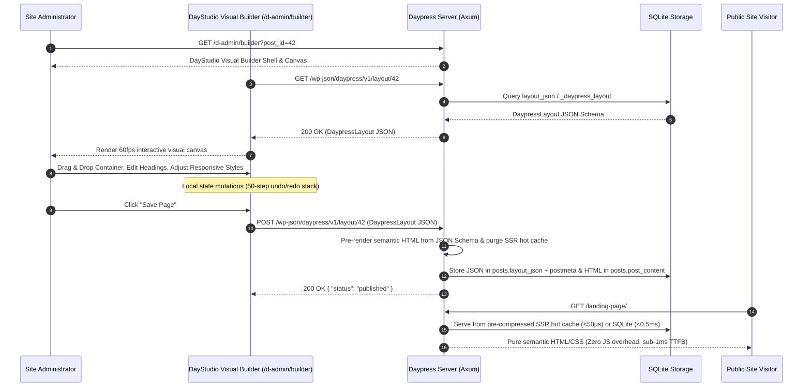
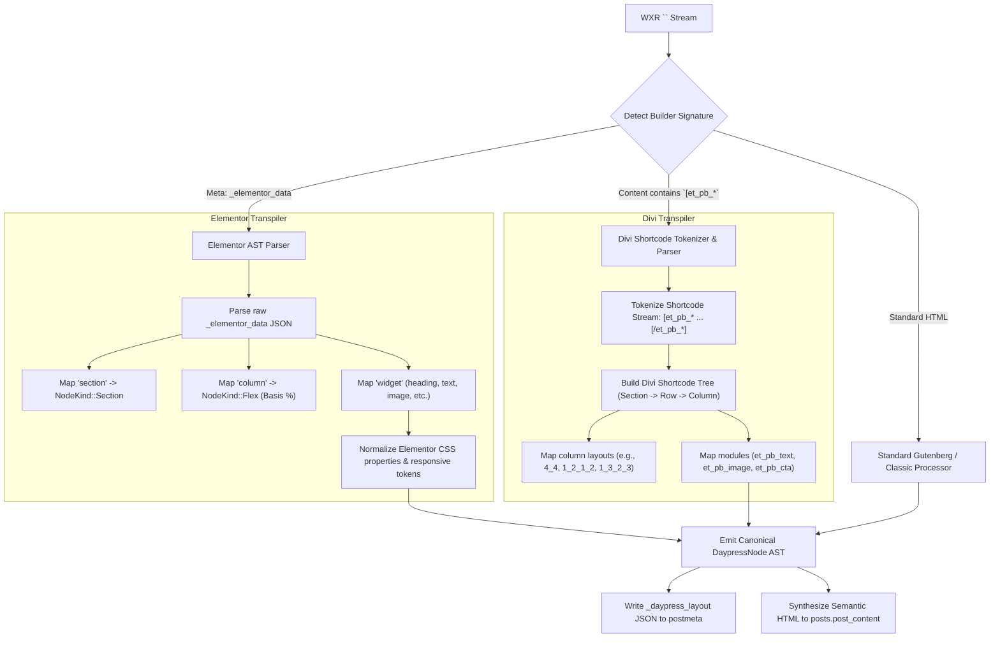
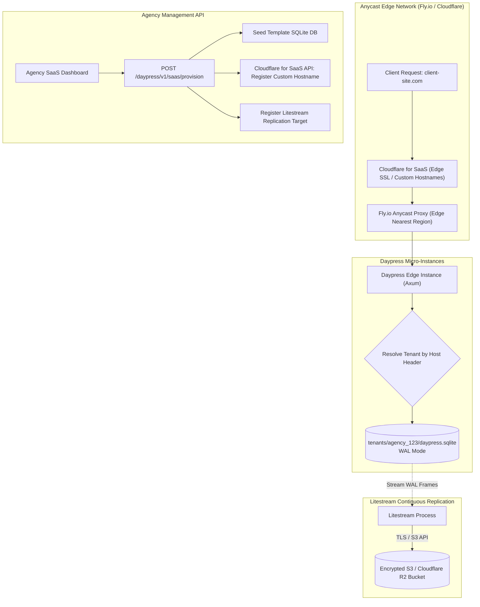
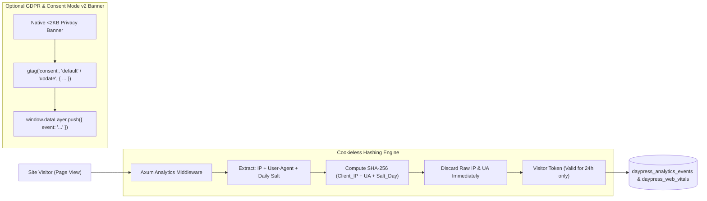
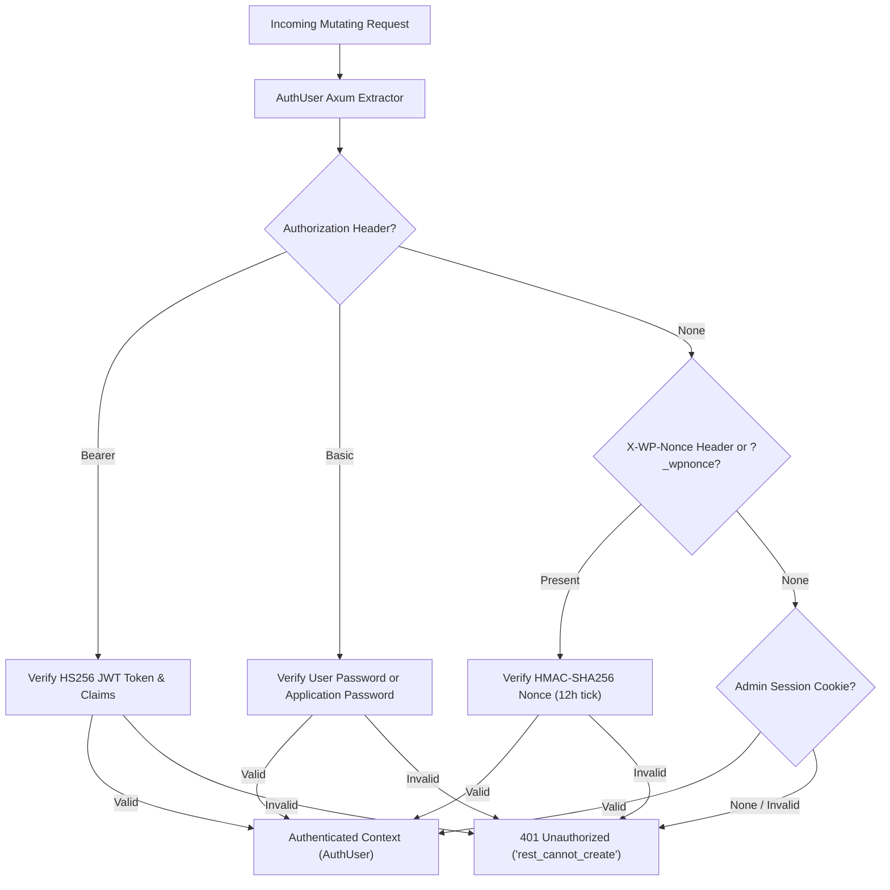
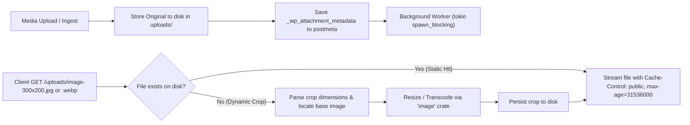
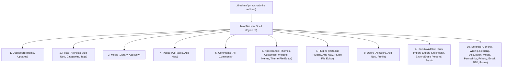
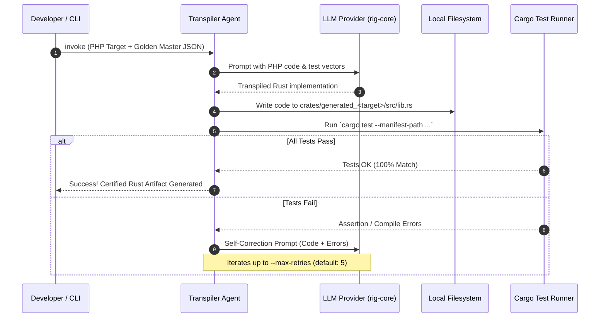

# Daypress Architecture Specification & Strategic Roadmap

This document provides a comprehensive technical overview and strategic engineering specification for Daypress: system design, crate separation, concurrency model, database persistence, visual page builder architecture, page builder AST transpilation, native subsystem convergence, edge SaaS multi-tenancy, cookieless analytics, and verification pipelines.

---

## 1. System Philosophy & Objectives

Daypress is engineered to satisfy the following core requirements:

1. **Drop-in WordPress REST API Compatibility**: Ensure client applications, mobile apps, headless frameworks (Next.js, Nuxt, Astro), and standard WordPress tools interact with Daypress without client modifications.
2. **Sub-Millisecond Read/Write Performance**: Eliminate external database socket roundtrips (MySQL/PostgreSQL) by utilizing an embedded SQLite engine configured with Write-Ahead Logging (WAL) and memory-mapped I/O.
3. **Interactive 60fps DayStudio Visual Page Builder**: Provide an instant drag-and-drop visual authoring canvas (`/d-admin/builder`) with responsive breakpoint parity (`1200px` / `768px` / `375px`) that saves to a strict, typed JSON Layout Schema (`DaypressLayout`), eliminating the lag and bloat of legacy PHP page builders.
4. **70%+ Market Capture via AST Transpilation**: Natively ingest and transpile Elementor (`_elementor_data` JSON), Divi (Divi 4 nested shortcodes & Divi 5 blocks), Gutenberg (`<!-- wp:* -->` + `theme.json` v2), and raw HTML5/CSS layouts during JSON bundle, WXR, and MCP imports, mapping them deterministically to the Daypress JSON Layout Schema.
5. **Zero "Plugin Tax" Core Convergence**: Replace the bloated, expensive plugin stack (WP Mail SMTP, Yoast/RankMath, WPForms, ACF Pro, Polylang, MailPoet, MonsterInsights) with compile-time embedded, native Rust subsystems for transactional email (`lettre`), dynamic SEO/sitemaps & WCAG auditing, FormStudio, Custom Post Types & Structured Fields, multilingual (`i18n`), newsletters, outbound webhooks, A/B testing, and sandboxed WebAssembly (`.wasm`) extensions.
6. **Edge Publishing, TLS & Continuous Replication**: Support 1-click static edge publishing (Cloudflare Pages, Netlify, local `.zip`), built-in automatic Let's Encrypt TLS (`--tls-domain`), S3/Cloudflare R2 media offload, and continuous zero-data-loss SQLite WAL streaming.
7. **Privacy-First European Compliance**: Provide native, cookieless, zero-consent-banner analytics powered by daily rotating salted IP hashes and Real-User Core Web Vitals (`LCP`, `INP`, `CLS`, `TTFB`), paired with an optional GDPR/ePrivacy & Google Consent Mode v2 banner.
8. **Strict Memory Safety & Zero Panics**: Ensure request handlers never invoke `.unwrap()` or panic on malformed user input or missing database records.
9. **Verified Modernization Pipeline**: Provide deterministic, automated transpilation of legacy WordPress PHP routines into safe Rust using LLM-assisted Golden Master differential testing.

---

## 2. Workspace Organization

Daypress adheres to the standard Cargo **Virtual Workspace** pattern:

```
Daypress/
├── Cargo.toml                    # Root virtual workspace manifest
├── Cargo.lock
├── bin/                          # Cross-platform CLI runner scripts
│   ├── daypress-transpiler
│   └── daypress-transpiler.bat
├── crates/
│   ├── daypress-server/          # Primary Axum server, API, SSR, Database, Native Subsystems
│   │   ├── Cargo.toml
│   │   ├── src/
│   │   │   ├── main.rs           # Server entrypoint, CLI flags (including doctor, reset-password, --mcp-stdio, --tls-domain)
│   │   │   ├── lib.rs            # Library entrypoint exporting create_app and services
│   │   │   ├── auth.rs           # Sessions, Nonces, App Passwords, JWT, 2FA Challenge, Role Capabilities
│   │   │   ├── totp.rs           # RFC 6238 TOTP & single-use recovery code cryptography
│   │   │   ├── v10_readiness.rs  # 1.0 Security & Readiness Audit, Schema v100, Wasm ABI v1 & Benchmark Suite
│   │   │   ├── domain/           # Hexagonal Domain Models, Errors, and Repository Output Ports
│   │   │   ├── application/      # CmsService use-case orchestration
│   │   │   ├── adapters/         # Hexagonal Adapters (modular SQLite database & MCP server)
│   │   │   │   ├── database/     # Modular Rusqlite repositories (posts, posts_write, post_ast, revisions, users, migration, taxonomies, comments, scheduling, newsletters, webhooks_shortlinks, wasm_extensions, etc.)
│   │   │   │   └── mcp/          # Built-in JSON-RPC Model Context Protocol server (47 tools)
│   │   │   ├── api/              # WordPress REST API v2 & Daypress v1 controllers
│   │   │   ├── handlers/         # HTTP route handlers (Public SSR, Admin Portal, Onboarding, 2FA)
│   │   │   ├── importer/         # Streaming WXR 1.2 & JSON bundle migration pipeline
│   │   │   ├── theme_builder/    # Display conditions, header/footer matrix, and dynamic AST hydration
│   │   │   ├── publisher/        # Static site & Cloudflare Pages/Workers/Vercel/Netlify edge publisher
│   │   │   └── templates/        # Modular Server-Side Rendering & DayStudio Visual Builder
│   │   │       ├── public/       # Zero-JS public frontend SSR templates
│   │   │       └── admin/        # Admin portal & DayStudio Visual Builder (`builder/`, `editor/`, `users.rs`, `tools.rs`, etc.)
│   │   ├── static/               # Bundled assets (fonts, icons, starter SVGs)
│   │   └── tests/                # Automated HTTP, DB, migration, and adversarial integration tests
│   ├── daypress-ast/             # Universal Page Builder AST Transpiler & Fidelity Analyzer
│   │   ├── Cargo.toml
│   │   └── src/
│   │       ├── lib.rs            # Public crate facade & exports
│   │       ├── fidelity.rs       # Pre-flight & post-import AST fidelity scorecard & builder dispatcher
│   │       ├── daystudio/        # Elementor `_elementor_data` JSON AST transpiler & widget mappers
│   │       ├── divi/             # Divi 4 shortcode & Divi 5 block AST transpiler
│   │       ├── gutenberg/        # Gutenberg block grammar & `theme.json` v2 compiler
│   │       ├── html_transpiler/  # Raw HTML/CSS to native AST layout transpiler
│   │       ├── render/           # Zero-JS semantic HTML/CSS compiler & leak-firewall sanitizer
│   │       └── schema/           # Canonical `DaypressLayout`, `DaypressNode`, `NodeKind`, `StyleProperties`
│   ├── daypress-wasm/            # Sandboxed WebAssembly (.wasm) Extension Engine
│   │   ├── Cargo.toml
│   │   └── src/lib.rs            # Wasm binary validator, fuel-metered stack VM, capability gate & compiler
│   ├── daypress-transpiler/      # AI Transpiler CLI verification agent
│   │   ├── Cargo.toml
│   │   └── src/main.rs           # Multi-attempt compilation and Golden Master testing
│   └── generated_slugify/        # Verified transpiled WordPress slugifier
│       ├── Cargo.toml
│       └── src/lib.rs            # Mathematical equivalence verified against WP
├── schemas/                      # Reference SQLite fixtures & JSON schemas
├── uploads/                      # Media uploads directory
└── .github/workflows/ci.yml      # Automated GitHub Actions CI pipeline
```

---

## 3. High-Level System Architecture

```mermaid
flowchart TD
    subgraph Edge ["Edge Infrastructure Layer (Fly.io & Cloudflare)"]
        Client["Browsers / Mobile Apps / Headless Frontends"] --> CF["Cloudflare for SaaS (SSL / Custom Hostnames)"]
        CF --> Fly["Fly.io Anycast Edge Nodes (Daypress Instances)"]
    end

    subgraph CoreApp ["Daypress Server (Axum 0.8)"]
        Fly --> Router["Axum HTTP Router & Middleware"]
        Router --> Auth["Authentication & Nonces (auth.rs)"]
        
        Auth --> REST["WP REST API v2 & Daypress v1 (api.rs)"]
        Auth --> SSR["Public SSR Engine (templates/public.rs)"]
        Auth --> AdminSSR["Admin Shell SSR (templates/admin/)"]
        Auth --> Subsystems["Native Subsystems (Email, SEO, Forms)"]
        Auth --> Analytics["Cookieless Analytics Ingest (analytics.rs)"]
    end

    subgraph ClientBuilder ["DayStudio Visual Page Builder & MCP"]
        AdminSSR -->|Loads Canvas| DayStudio["DayStudio Visual Builder (/d-admin/builder)"]
        DayStudio -->|REST API (DaypressLayout JSON)| REST
        MCPClient["AI Agents (Claude Code / Cursor / Antigravity)"] -->|JSON-RPC 2.0 (POST /mcp or --mcp-stdio)| REST
    end

    subgraph Ingestion ["Ingestion & Transpilation Pipeline"]
        WXRUpload["WXR XML Upload"] --> StreamingParser["Streaming XML Parser (wxr.rs)"]
        StreamingParser --> AST["AST Translation Layer (daypress-ast)"]
        AST -->|Parse _elementor_data| ElemTrans["Elementor JSON Parser"]
        AST -->|Parse [et_pb_*]| DiviTrans["Divi Shortcode Parser"]
        ElemTrans --> DaypressJSON["Canonical DaypressLayout JSON"]
        DiviTrans --> DaypressJSON
    end

    subgraph Persistence ["Storage & Disaster Recovery"]
        REST --> DB[("SQLite Database (WAL Mode)")]
        SSR --> DB
        Subsystems --> DB
        Analytics --> DB
        DaypressJSON --> DB
        
        DB -.->|Continuous WAL Replication| Litestream["Litestream Daemon"]
        Litestream -.->|Encrypted S3 Snapshots| S3[("S3 / Cloudflare R2 Bucket")]
    end
```

---

## 4. Web & HTTP Pipeline (`daypress-server`)

### Routing Framework
The HTTP engine is powered by **Axum 0.8** on top of **Tokio** and **Tower HTTP**. The routing hierarchy is structured into dedicated operational domains:

```mermaid
flowchart TD
    Req["Incoming HTTP Request"] --> Trace["TraceLayer (Request Logging)"]
    Trace --> Cors["CorsLayer (Cross-Origin Resource Sharing)"]
    Cors --> HostRouting["Multi-Tenant Host Router (Host Header)"]
    HostRouting --> Router["Axum Router"]

    Router -->|"/wp-json/wp/v2/*"| REST["WordPress REST API v2 Engine"]
    Router -->|"/wp-json/daypress/v1/*"| NRest["Daypress Extended APIs"]
    Router -->|"/mcp"| MCP["Model Context Protocol (JSON-RPC 2.0)"]
    Router -->|"/d-admin/builder*"| Builder["DayStudio Visual Page Builder"]
    Router -->|"/d-admin/*"| Admin["Admin Portal Shell (templates/admin/)"]
    Router -->|"/wp-admin/*"| RedirectAdmin["Admin Redirect (/d-admin/)"]
    Router -->|"/sitemap*.xml"| Sitemap["Native Dynamic SEO Sitemap Stream"]
    Router -->|"/n-api/analytics/event"| AnalyticsRoute["Cookieless Analytics Ingest"]
    Router -->|"/static/*, /uploads/*"| Static["ServeDir (Static & Dynamic Media)"]
    Router -->|"/" or "/{slug}/"| PublicSSR["Public Editorial SSR (<1ms TTFB)"]
```

### Decoupled Application Architecture
`main.rs` is solely responsible for binary initialization:
- Parsing command-line flags and environment variables via `clap`.
- Initializing structured logging with `tracing-subscriber` and `EnvFilter`.
- Instantiating the SQLite database with WAL and foreign keys enabled.
- Spawning background worker queues for Litestream replication, email sending, and analytics buffering.
- Binding the `tokio::net::TcpListener`.
- Handling graceful shutdown via `tokio::signal::ctrl_c()`.

---

## 5. Error Handling & WordPress REST Compliance

To ensure API clients receive idiomatic WordPress responses even during error conditions, Daypress implements a dedicated error taxonomy in `errors.rs`:

```rust
#[derive(Debug, thiserror::Error)]
pub enum AppError {
    #[error("Database error: {0}")]
    Database(#[from] rusqlite::Error),

    #[error("Resource not found: {0}")]
    NotFound(String),

    #[error("Bad request: {0}")]
    BadRequest(String),

    #[error("Unauthorized: {0}")]
    Unauthorized(String),

    #[error("Forbidden: {0}")]
    Forbidden(String),

    #[error("Internal server error: {0}")]
    Internal(String),

    #[error("AST Transpilation error: {0}")]
    Transpilation(String),
}
```

### Error Serialization
`AppError` implements Axum's `IntoResponse` trait, translating internal variants into standard WordPress JSON errors:

```json
{
  "code": "rest_not_found",
  "message": "Resource not found: Post 9999",
  "data": {
    "status": 404
  }
}
```

| `AppError` Variant | HTTP Status | WP Error Code |
|---|---|---|
| `NotFound(msg)` | `404 Not Found` | `rest_not_found` |
| `BadRequest(msg)` | `400 Bad Request` | `rest_invalid_param` |
| `Unauthorized(msg)` | `401 Unauthorized` | `rest_cannot_read` / `rest_cannot_create` |
| `Forbidden(msg)` | `403 Forbidden` | `rest_forbidden` |
| `Database(err)` | `500 Internal Server Error` | `database_error` |
| `Transpilation(err)`| `422 Unprocessable Entity`| `daypress_ast_error` |
| `Internal(msg)` | `500 Internal Server Error` | `internal_server_error` |

No request handler is permitted to invoke `.unwrap()` or panic.

---

## 6. Storage Engine & Database Design

### Embedded SQLite Persistence
Database interactions are managed through `rusqlite` with a thread-safe connection handle:

```rust
#[derive(Clone)]
pub struct Database {
    conn: Arc<Mutex<Connection>>,
    db_path: PathBuf,
}
```

### Performance & Concurrency Optimizations
1. **Write-Ahead Logging (WAL)**: `PRAGMA journal_mode = WAL;` enables concurrent readers while a single writer operates without lock starvation.
2. **Synchronous Mode**: `PRAGMA synchronous = NORMAL;` provides safe durability without excessive fsync penalties.
3. **Foreign Keys**: `PRAGMA foreign_keys = ON;` guarantees relational integrity across posts, taxonomies, options, forms, and analytics.
4. **Memory-Mapped I/O**: `PRAGMA mmap_size = 268435456;` (256MB) eliminates memory copy overhead between kernel and user space.
5. **Schema Versioning**: Monitored via `PRAGMA user_version;` to execute incremental migrations automatically upon startup.

---

## 7. The Visual Builder: DayStudio vs. Public SSR

Legacy WordPress relies heavily on server-rendered textareas (TinyMCE) or JavaScript-heavy block editors (Gutenberg) and monstrous third-party plugins (Elementor, Divi) that inject megabytes of bloated JavaScript and CSS. Daypress resolves this through a **Hybrid Architecture**:

- **Public Frontend**: Ultra-high-speed Server-Side Rendering (SSR) via Axum + an in-memory Gzip hot cache (`<50µs` P99 latency). Delivers static semantic HTML/CSS generated from the canonical JSON layout with sub-millisecond TTFB ($<1\text{ms}$) and zero client runtime overhead.
- **Editorial Experience**: The built-in **DayStudio Visual Builder** (`crates/daypress-server/src/templates/admin/builder/`) runs at `/d-admin/builder` with real-time drag-and-drop, responsive breakpoint switching (`1200px` / `768px` / `375px`), box-model inspector panels, and instant dual-write persistence to `posts.layout_json` and `postmeta._daypress_layout`.



### The Canonical JSON Layout Schema (`daypress-ast/src/schema.rs`)

All pages authored or transpiled in Daypress conform to a strict, typed layout tree:

```rust
use serde::{Deserialize, Serialize};

#[derive(Debug, Clone, Serialize, Deserialize)]
pub struct DaypressLayout {
    pub version: u32,
    pub root: DaypressNode,
    pub global_styles: GlobalStyleConfig,
}

#[derive(Debug, Clone, Serialize, Deserialize)]
pub struct DaypressNode {
    pub id: String,
    pub kind: NodeKind,
    pub styles: StyleProperties,
    pub children: Vec<DaypressNode>,
}

#[derive(Debug, Clone, Serialize, Deserialize)]
#[serde(tag = "type", content = "data")]
pub enum NodeKind {
    Section,
    Container,
    Grid { columns: u8, gap: u32 },
    Flex { direction: FlexDirection, justify: JustifyContent, align: AlignItems },
    Heading { text: String, level: u8 },
    Text { content_html: String },
    Image { src: String, alt: String, width: Option<u32>, height: Option<u32> },
    Button { text: String, url: String, target: String },
    Form { form_id: i64 },
    CustomHtml { raw: String },
}

#[derive(Debug, Clone, Default, Serialize, Deserialize)]
pub struct StyleProperties {
    pub padding: Spacing,
    pub margin: Spacing,
    pub typography: TypographyConfig,
    pub background: BackgroundConfig,
    pub border: BorderConfig,
    pub responsive: ResponsiveOverrides,
}
```

### Key Advantages
1. **Total Decoupling**: Visual structure is isolated from the storage engine. Layouts can be inspected, diffed with Git, and transformed into any target format.
2. **Instant Pre-Rendering**: The server renders HTML from the JSON schema once during mutation; public reads incur zero layout computation overhead.
3. **No Shortcode Hell**: Eliminates legacy regex-based PHP shortcode parsing at request runtime.

---

## 8. Page Builder Transpilation Engine (Elementor & Divi)

To capture the 70% WordPress market share dominated by visual builders, Daypress incorporates a native **AST (Abstract Syntax Tree) Translation Layer** (`crates/daypress-ast`) directly into the WXR streaming parser (`wxr.rs`).



### 1. Elementor Transpilation
Elementor stores page definitions as nested JSON inside `_elementor_data` postmeta. Daypress streams this JSON through `serde_json` and performs structural normalization:
- **Sections & Inner Sections**: Converted to `NodeKind::Section` and `NodeKind::Container`.
- **Columns**: Column widths expressed as percentages (`_column_size`) are converted to CSS Flexbox basis and Grid track tokens.
- **Widgets**: Mapped to native Daypress widgets (`heading`, `text-editor`, `image`, `icon-box`, `counter`, `accordion`, `form`).
- **Style Normalization**: Custom Elementor paddings, margins, responsive breakpoints (`tablet`, `mobile`), and typography settings are converted into canonical `StyleProperties`.

### 2. Divi Transpilation
Divi stores page layouts as deeply nested BBCode shortcodes in `post_content` (e.g. `[et_pb_section][et_pb_row][et_pb_column type="1_2"][et_pb_text]...[/et_pb_text][/et_pb_column]...[/et_pb_row][/et_pb_section]`).
- **Divi Lexer**: Tokenizes open tags, attribute keys, quoted attribute values, text bodies, and close tags.
- **Divi AST Parser**: Reconstructs the hierarchy of Section -> Row -> Column -> Module.
- **Column Layout Resolution**: Maps fractional Divi column types (`4_4`, `1_2, 1_2`, `1_3, 2_3`, `1_4, 1_4, 1_4, 1_4`) to proportional CSS Grid / Flexbox tokens in `DaypressNode`.
- **Module Attribute Mapping**: Parses colors, padding strings (`30px|||`), custom CSS rules, and animation classes directly into Daypress layout attributes.

### 3. Golden Master Transpilation Testing
Every transpilation mapping is mathematically certified through differential test suites:
- Input: Production Elementor and Divi exported XML fixtures.
- Execution: Parsed by `daypress-ast`.
- Output: Validated against golden visual snapshot assertions to ensure layout integrity.

---

## 9. Core Convergence: The Native Subsystems (Eliminating the "Plugin Tax")

A typical WordPress site incurs \$600–\$1,200/year in agency plugin licensing and suffering severe latency penalties from bloated PHP plugins. Daypress eliminates this "Plugin Tax" by embedding the core functionality directly into the compiled Rust binary:

```
┌────────────────────────────────────────────────────────────────────────┐
│                   THE DAYPRESS NATIVE CONVERGENCE                      │
├───────────────────────┬────────────────────────────────────────────────┤
│ Legacy WordPress      │ Daypress Native Rust Subsystem                 │
├───────────────────────┼────────────────────────────────────────────────┤
│ WP Mail SMTP ($99/yr) │ native lettre SMTP/SES/SendGrid & Spool Engine │
│ Yoast SEO ($99/yr)    │ Native JSON-LD, Dynamic OG & Streaming Sitemap │
│ WPForms Pro ($199/yr) │ Declarative Forms, Honeypot & Signed Webhooks  │
│ WP Rocket ($59/yr)    │ Built-in SQLite WAL + Static Asset On-The-Fly  │
│ Cookiebot ($140/yr)   │ Native Cookieless Analytics (Zero Banner)      │
└───────────────────────┴────────────────────────────────────────────────┘
```

### 1. Native Email Subsystem (`crates/daypress-server/src/email.rs`)
Powered by the **`lettre`** crate, replacing WP Mail SMTP:
- **Multiple Transports**: Direct SMTP, Amazon SES, SendGrid, Mailgun, or local Postfix/Sendmail with automatic fallback.
- **Asynchronous Spooling**: Outbound messages are pushed to an in-memory Tokio mpsc channel and written to a SQLite spool queue (`daypress_email_queue`), ensuring HTTP request handlers never block on external SMTP handshakes.
- **DKIM Signing & TLS**: Built-in cryptographic DKIM header signing using RSA/Ed25519 keys stored in `options`.
- **Audit & Delivery Logging**: Complete delivery lifecycle tracking in `daypress_email_log` (recipient, subject, timestamp, delivery status, latency, error details).
- **Interactive Admin View**: Configurable at `/d-admin/options-email.php` with a built-in diagnostic test email dispatcher.

### 2. Native Dynamic SEO Engine (`crates/daypress-server/src/seo.rs`)
Replaces Yoast SEO and RankMath:
- **On-the-Fly JSON-LD Generation**: Emits schema.org compliant structured data (`Article`, `BreadcrumbList`, `Organization`, `WebSite`, `Product`) tailored dynamically to each content type.
- **OpenGraph & Twitter Cards**: Generates complete meta tags (`og:title`, `og:description`, `og:image`, `twitter:card`) derived from post titles, excerpts, and featured media.
- **Streaming XML Sitemaps**: High-performance streaming sitemap endpoints (`/sitemap.xml`, `/sitemap-posts.xml`, `/sitemap-pages.xml`, `/sitemap-taxonomies.xml`) reading directly from SQLite with index caching, handling 50,000+ URLs in under 10ms.
- **Canonical URLs & Redirect Manager**: Automatically resolves trailing slash conventions, permalink updates, and custom 301/302 redirects without .htaccess rules.

### 3. Native Forms, Anti-Spam & Webhook Engine (`crates/daypress-server/src/forms.rs`)
Replaces WPForms and Gravity Forms:
- **Declarative Form Schema**: Forms are defined as typed JSON objects with client-side and server-side validation rules.
- **Submission Endpoint**: Handled via `POST /wp-json/daypress/v1/forms/{id}/submit`.
- **Zero-CAPTCHA Anti-Spam Engine**:
  1. *Invisible Honeypot Trap*: Hidden fields that bots fill but humans cannot see.
  2. *Cryptographic Time-Lock Token*: HMAC-SHA256 timestamp token verifying that submissions take $>2\text{s}$ (blocking instant bot scripts) and $<24\text{h}$ (blocking replay attacks).
  3. *IP Rate Limiting*: Leaky bucket limiter restricting submissions per IP address.
- **Multi-Action Dispatch Pipeline**: Upon successful submission, Daypress atomically:
  1. Records the submission in `daypress_form_entries`.
  2. Dispatches an alert email to the site owner via the native `lettre` engine.
  3. Emits an asynchronous HTTP webhook (with HMAC-SHA256 signature header `X-Daypress-Signature`) to Zapier, Make, n8n, or agency CRMs.

---

## 10. Edge Infrastructure & Agency SaaS Multi-Tenancy

For the **\$199/month Agency SaaS** offering, Daypress is engineered to scale across distributed edge compute clusters with sub-second provisioning and continuous disaster recovery.



### 1. Continuous SQLite WAL Replication (Litestream)
Embedded SQLite requires robust disaster recovery on ephemeral edge nodes. Daypress couples directly with **Litestream**:
- **Continuous Frame Streaming**: Litestream monitors the SQLite `-wal` file and replicates committed transaction frames to S3/Cloudflare R2 within seconds.
- **Point-in-Time Recovery (PITR)**: Agencies can restore a client's database to any specific second in the past 30 days.
- **Sub-500ms Cold Start Recovery**: If an edge node restarts or relocates, Litestream reconstitutes the SQLite database from the latest snapshot and replayed WAL deltas before the Axum listener binds.
- **Zero Data Loss (RPO $<1\text{s}$, RTO $<5\text{s}$)**.

### 2. Multi-Tenant Custom Domains via Cloudflare for SaaS
Daypress integrates with Cloudflare for SaaS via Cloudflare API v4:
1. **Automated Hostname Registration**: When an agency adds a client domain (`example.com`), Daypress invokes the Cloudflare API to provision a Custom Hostname.
2. **Automated SSL/TLS Provisioning**: Cloudflare provisions and renews SSL certificates (Let's Encrypt / Google Trust Services) with zero manual intervention.
3. **CNAME Fallback Routing**: Clients simply configure a CNAME pointing to `origin.agency-saas.com`.
4. **Tenant Context Extraction**: An Axum middleware inspects the incoming `Host` header, maps the domain to the associated `tenant_id`, and routes queries to the corresponding isolated SQLite database.

---

## 11. Cookieless Analytics, Web Vitals & Consent Mode v2

European agencies require strict GDPR, ePrivacy Directive, and PECR compliance without annoying cookie consent banners degrading user experience. Daypress includes a native **Privacy-First Analytics & Real-User Web Vitals Subsystem** alongside an optional **Google Consent Mode v2 Banner**.



### 1. Native Cookieless Analytics & Real-User Web Vitals (`crates/daypress-server/src/adapters/database/forms_analytics.rs`)
- **Daily Rotating Salt Hashing**:
  $$\text{VisitorToken} = \text{SHA-256}(\text{ClientIP} \parallel \text{UserAgent} \parallel \text{DailySalt} \parallel \text{SiteSecret})$$
  Because `DailySalt` changes cryptographically every 24 hours at midnight UTC, visitors cannot be tracked across different days or different websites.
- **Zero Cookies & Zero Storage**: No `Cookie`, `localStorage`, or `IndexedDB` access is required for first-party analytics. The tracking is 100% compliant with GDPR without requiring a consent banner.
- **Real-User Core Web Vitals (`LCP`, `INP`, `CLS`, `TTFB`)**: A `<1KB` `PerformanceObserver` beacon (`POST /wp-json/daypress/v1/web-vitals`) records field metrics and aggregates `p75` percentiles and `Good` / `Needs Improvement` / `Poor` route ratings.
- **Built-in Dashboard**: Native visualizations in `/d-admin/analytics` displaying unique visitors, page views, bounce rate, referrers,UTM campaigns, device/OS breakdown, country geo-location, and Core Web Vitals, with 1-click CSV export.

### 2. Optional Privacy Banner & Google Tag Manager Consent Mode v2
For sites that load optional third-party marketing or analytics scripts:
- **Configurable in `/d-admin/options-privacy`**: Enable a lightweight (`<2KB`), customizable GDPR/ePrivacy banner (`Accept All`, `Reject Non-Essential`, `Customize`).
- **Default Consent Enforcement**: Emits strict Google Consent Mode v2 defaults before any third-party script executes:
  ```javascript
  gtag('consent', 'default', {
    'ad_storage': 'denied',
    'analytics_storage': 'denied',
    'ad_user_data': 'denied',
    'ad_personalization': 'denied'
  });
  ```
- **Dynamic Updates**: Updating visitor consent preferences immediately dispatches `gtag('consent', 'update', ...)` to `window.dataLayer`.

---

## 12. Security & Production Hardening

- **SQL Injection Prevention**: All queries in `db.rs` utilize parameterized statements (`params![...]` or named parameters). Dynamic string interpolation into SQL queries is strictly prohibited.
- **Path Traversal Protection**: Upload handlers sanitize filenames and restrict uploads strictly within the designated `uploads/` directory.
- **Resource Constraints**: Upload body limits and pagination limits are enforced by default to prevent denial-of-service (DoS) via unbounded memory allocations.
- **Memory Safety**: 100% Rust codebase; unsafe blocks are forbidden in application logic.
- **Zero Panics**: All recoverable errors are mapped to `AppError` and translated to standard HTTP status codes.

---

## 13. Authentication & Nonce Subsystem (`auth.rs`)

Daypress enforces write permissions across all mutating REST endpoints (`POST`, `PUT`, `DELETE`), ensuring zero-friction interoperability with standard WordPress headless clients and mobile apps:



### Key Capabilities
1. **Application Passwords (WP 5.6+)**: Managed via `GET/POST/DELETE /wp-json/wp/v2/users/{id}/application-passwords`. Stored securely as SHA-256 hashes in `application_passwords`.
2. **Bearer JWT Tokens (`jwt-auth/v1`)**: Tokens signed via HS256 with user context, issued at `POST /wp-json/jwt-auth/v1/token` and validated at `/wp-json/jwt-auth/v1/token/validate`.
3. **Cryptographic Nonces (`X-WP-Nonce`)**: 10-character HMAC-SHA256 nonces computed against 12-hour validity ticks (with 24-hour total verification tolerance matching WordPress core).

---

## 14. Media Asset Pipeline & On-The-Fly CDN (`media.rs`)

To eliminate thumbnail generation bottlenecks during multi-gigabyte data migrations, Daypress combines asynchronous background workers with an edge-optimized on-the-fly thumbnail engine:



### Advantages
- **Instantaneous Bulk Imports**: Importing 2GB+ of images does not block requests or run out of memory.
- **Modern WebP Transcoding**: Automatically derives and serves modern `.webp` variants for all uploaded graphics.
- **Complete Path Preservation**: Standard WordPress cropped file naming (`{file}-{width}x{height}.{ext}`) is preserved for drop-in theme and frontend compatibility.

---

## 15. Streaming WXR Ingestion Subsystem (`wxr.rs`)

Rather than requiring custom JSON bundles, Daypress directly accepts native WordPress XML export files (`.xml` / WXR 1.2):

- **Event-Driven Streaming (`quick-xml`)**: Operates on a reusable byte buffer without reading the entire XML document into memory.
- **Bounded Memory Profile**: Memory consumption remains $O(1)$ regardless of whether the dump is 5MB or 2GB.
- **Atomic Persistence**: Channels, taxonomies, posts, pages, attachments, postmeta (`_thumbnail_id`, `_elementor_data`), and comments are committed inside atomic SQLite transactions.
- **Inline AST Transpilation**: During post parsing, Elementor JSON and Divi shortcodes are converted into `DaypressLayout` JSON trees before committing to disk.

---

## 16. WordPress Administration Architecture (10 Menus & 32 Submenus)

Daypress delivers 100% route and visual compatibility with the complete default WordPress administration hierarchy:



### Route Mapping & Implementation Ledger

| Top-Level Menu | Submenu Item | Admin Route URL | Template Handler | DB & Data Persistence |
|---|---|---|---|---|
| **Dashboard** | Home | `/d-admin/index.php` | `render_admin_dashboard` | `posts`, `comments`, `options` |
| | Updates | `/d-admin/update-core.php` | `render_wp_updates_view` | Core release versions, schema re-sync, VACUUM |
| **Posts** | All Posts | `/d-admin/edit.php` | `render_admin_posts` | `posts` (`post_type='post'`), pagination & trash |
| | Add New | `/d-admin/post-new.php` | `render_admin_post_new` | Visual Builder launch or classic authoring |
| | Categories | `/d-admin/edit-tags.php?taxonomy=category` | `render_admin_tags` | `terms`, `term_taxonomy` (`category`) |
| | Tags | `/d-admin/edit-tags.php?taxonomy=post_tag` | `render_admin_tags` | `terms`, `term_taxonomy` (`post_tag`) |
| **Media** | Library | `/d-admin/upload.php` | `render_admin_media` | `posts` (`post_type='attachment'`), WebP thumbnails |
| | Add New | `/d-admin/media-new.php` | `render_wp_media_new_view` | Multi-file drag & drop upload dropzone |
| **Pages** | All Pages | `/d-admin/edit.php?post_type=page` | `render_admin_posts` | `posts` (`post_type='page'`) hierarchical listing |
| | Add New | `/d-admin/post-new.php?post_type=page` | `render_admin_post_new` | Visual Builder launch or classic authoring |
| **Comments** | All Comments | `/d-admin/edit-comments.php` | `render_wp_comments_view` | `comments` moderation: Approve, Spam, Trash, Delete |
| **Appearance** | Themes | `/d-admin/themes.php` | `render_wp_themes_view` | Active theme display, theme switching |
| | Customize | `/d-admin/customize.php` | `render_wp_customize_view` | Live responsive preview iframe with real-time controls |
| | Widgets | `/d-admin/widgets.php` | `render_wp_widgets_view` | Drag-and-drop widget placement for Sidebar & Footers |
| | Menus | `/d-admin/nav-menus.php` | `render_wp_nav_menus_view` | Navigation menu structure, page links, hierarchy |
| | Theme File Editor | `/d-admin/theme-editor.php` | `render_wp_theme_editor_view` | Theme source inspector with syntax highlighting |
| **Plugins** | Installed Plugins | `/d-admin/plugins.php` | `render_wp_plugins_view` | Plugin cards, active/inactive state toggles |
| | Add New | `/d-admin/plugin-install.php` | `render_wp_plugin_install_view` | Plugin search directory & `.zip` bundle upload |
| | Plugin File Editor | `/d-admin/plugin-editor.php` | `render_wp_plugin_editor_view` | Sandboxed extension source code inspector |
| **Users** | All Users | `/d-admin/users.php` | `render_admin_users` | User directory, roles, and profile management |
| | Add New | `/d-admin/user-new.php` | `render_admin_user_new` | User creation with role assignments & validation |
| | Profile | `/d-admin/profile.php` | `render_admin_profile` | User password, email, and Application Passwords |
| **Tools** | Available Tools | `/d-admin/tools.php` | `render_wp_tools_view` | System diagnostics & VACUUM storage utilities |
| | Import | `/d-admin/import.php` | `render_wp_import_view` | Streaming WordPress WXR XML & AST transpiler |
| | Export | `/d-admin/export.php` | `render_wp_export_view` | Streaming WXR XML and complete JSON backup generator |
| | Site Health | `/d-admin/site-health.php` | `render_wp_site_health_view` | Security audits, SQLite diagnostics, Litestream status |
| | Export Personal Data | `/d-admin/export-personal-data.php` | `render_wp_export_personal_data_view` | GDPR compliance personal data exporter |
| | Erase Personal Data | `/d-admin/erase-personal-data.php` | `render_wp_erase_personal_data_view` | GDPR data anonymizer across SQLite tables |
| **Settings** | General | `/d-admin/options-general.php` | `render_admin_settings` | Site title, tagline, URLs, admin email (`options`) |
| | Writing | `/d-admin/options-writing.php` | `render_wp_settings_writing_view` | Default category, post formats, mail server settings |
| | Reading | `/d-admin/options-reading.php` | `render_wp_settings_reading_view` | Front page display, posts per page, RSS limits |
| | Discussion | `/d-admin/options-discussion.php` | `render_wp_settings_discussion_view` | Comments open/closed, thread nesting, avatars |
| | Media | `/d-admin/options-media.php` | `render_wp_settings_media_view` | Thumbnail, medium, and large dimensions |
| | Permalinks | `/d-admin/options-permalink.php` | `render_wp_settings_permalink_view` | URL rewrite structures (`/%postname%/`, date, numeric) |
| | Privacy | `/d-admin/options-privacy.php` | `render_wp_settings_privacy_view` | Designated privacy policy page assignment |
| | Email (Native) | `/d-admin/options-email.php` | `render_wp_settings_email_view` | SMTP/SES credentials, DKIM keys, email logs |
| | SEO (Native) | `/d-admin/options-seo.php` | `render_wp_settings_seo_view` | Meta templates, JSON-LD defaults, XML sitemaps |
| | Forms (Native) | `/d-admin/options-forms.php` | `render_wp_settings_forms_view` | Form definitions, submissions, webhook endpoints |
| | Analytics (Native)| `/d-admin/analytics.php` | `render_wp_analytics_dashboard` | Cookieless privacy metrics, visitor trends |

---

## 17. The Verification Loop (`daypress-transpiler`)

To port complex legacy WordPress business logic into Rust with mathematical certainty, Daypress uses an automated **Golden Master Verification Loop**:



---

## 18. Strategic Roadmap & Execution Phasing

See [ROADMAP.md](ROADMAP.md) for the complete milestone checklist.

| Milestone | Key Deliverables | Status |
| :--- | :--- | :--- |
| **`0.1` — Core & DayStudio** | Axum HTTP, Rusqlite WAL, WP REST v2, DayStudio Visual Builder, Elementor/Divi/Gutenberg AST transpilers, WXR & JSON importers, MCP server | **Shipped** |
| **`0.2` — Edge Publisher & Onboarding** | Static Edge Publisher (Cloudflare Pages, Netlify, local), 4-step Onboarding & AI Agent Launchpad, self-updater with rollback, responsive canvas parity | **Shipped** |
| **`0.3.0` — Security & Fidelity** | RFC 6238 TOTP 2FA & recovery codes, fine-grained 5-role capability matrix, Migration Fidelity Analyzer (`/d-admin/migration-report`), multi-arch GHCR Docker | **Shipped** |
| **`0.4.0` — Forms, Analytics & Hot Cache** | FormStudio & Submissions Vault, Cookieless Analytics dashboard, GDPR/Consent Mode v2 banner, `<50µs` pre-compressed Gzip SSR hot cache | **Shipped** |
| **`0.5.1` — Theme Builder, DAM & Edge TLS** | Dynamic Theme Templates, Synced Components (`Symbol`), Mega Menus, Popups, Media DAM folders & SVG sanitizer, automatic Let's Encrypt TLS & S3/R2 | **Shipped** |
| **`0.6.0` — CPTs & Structured Fields** | Custom Post Types & Taxonomies, ACF-parity Structured Field Groups (`Repeater`, `Media`, `Relationship`), filterable `LoopGrid` collection grids | **Shipped** |
| **`0.7.0` — Search, Social Cards & Linter** | SQLite FTS5 BM25 instant search, dynamic SVG/PNG OpenGraph social cards, rich Schema.org JSON-LD, live WCAG 2.1 AA/AAA & SEO linter | **Shipped** |
| **`0.8.0` — Multilingual & Editorial** | Multi-language (`i18n`) routing & `hreflang` matrix, secret preview links, scheduled revisions, visual side-by-side AST revision diffs | **Shipped** |
| **`0.8.5` — WP-Native Admin Ergonomics** | Screen Options drawer, draggable/collapsible meta boxes, inline ACF editor blocks, Quick Edit & Bulk Edit modals, 1-click Empty Trash | **Shipped** |
| **`0.9.0` — Growth & Wasm Extensions** | Built-in Newsletters & double opt-in, `/go/*` shortlinks, HMAC-SHA256 outbound webhooks, server-side A/B testing, Real-User Web Vitals, `daypress-wasm` `.wasm` sandbox | **Shipped** |
| **`1.0` — First Stable Release** | 10-point Security & Production Readiness Audit (`daypress doctor`), reproducible benchmarks ([BENCHMARKS.md](BENCHMARKS.md)), SQLite Schema `v100` & Wasm ABI `v1` contracts, 70%+ WP Migration Corpus Sign-Off | **Shipped (`v1.0.1`)** |
