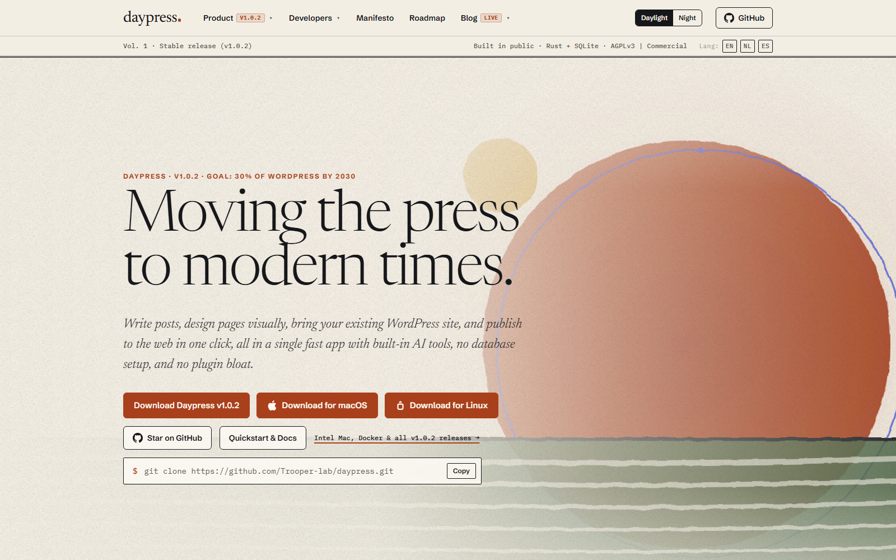
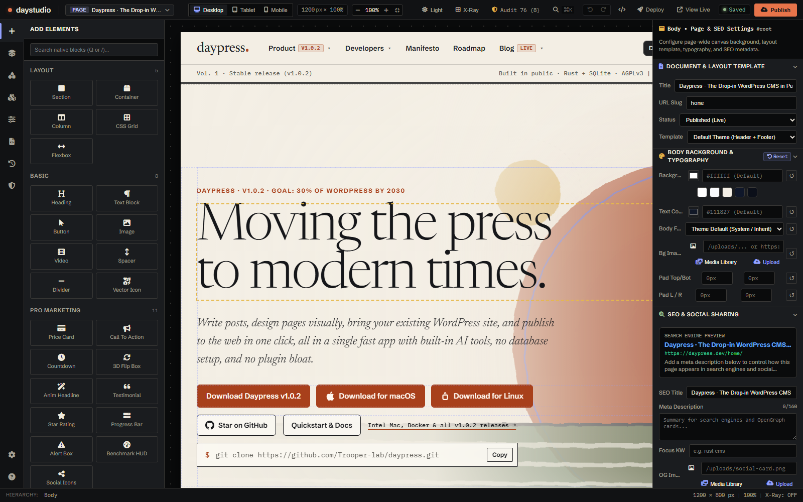
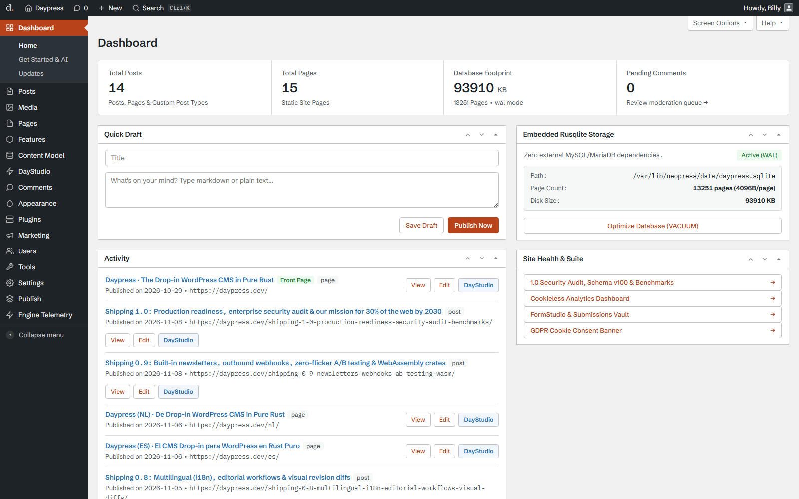
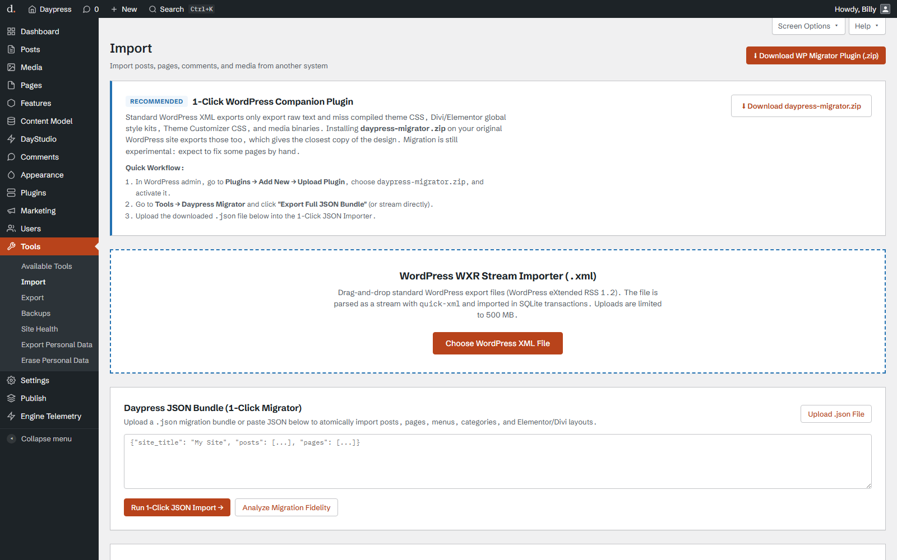
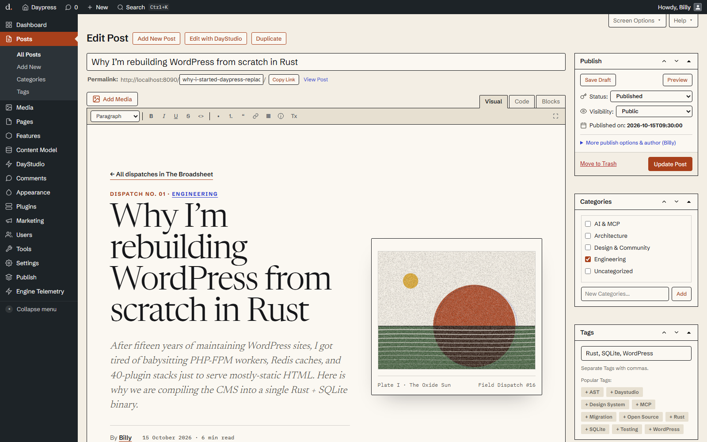
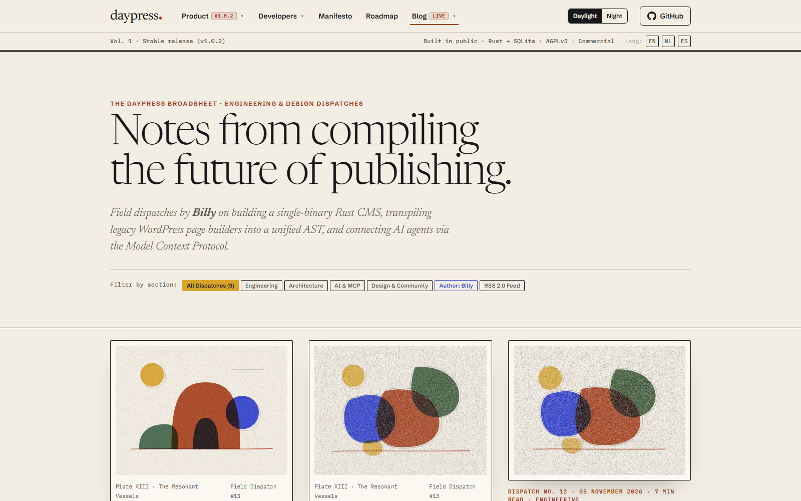

# Daypress

[](https://github.com/Trooper-lab/daypress/actions/workflows/ci.yml)
[](LICENSE)

**Daypress is a self-hosted CMS written in Rust.** It gives you a WordPress-style admin, a visual page builder, and a WordPress-compatible REST API in a single binary with an embedded SQLite database: no PHP, no MySQL.

The long-term goal is a CMS that most WordPress sites can move to with their content and design intact. **We are not there yet.** Today Daypress is good for building new sites, and it has an experimental WordPress importer that we want to improve together with the community.

> **Status: Stable (`v1.0.1`).** Daypress includes a locked SQLite Schema Contract (`v100`), WebAssembly Host ABI (`v1`), a built-in 10-point Security & Production Readiness Audit (`daypress doctor` & `/d-admin/site-health`), reproducible performance benchmarks ([`BENCHMARKS.md`](BENCHMARKS.md)), and `70%+` (`95%–100%` tested) 1-Click WordPress migration sign-off across Elementor, Divi, Gutenberg, and Classic sites. Always keep backups when upgrading or migrating production sites.

| Public site | DayStudio visual builder |
| :---: | :---: |
|  |  |

<sub>The screenshots use made-up demo content.</sub>

---

## What works today

**Running it**
- One binary built with Axum and Tokio, with an embedded SQLite database (WAL mode). Static assets are compiled into the binary.
- First-time browser onboarding wizard (`/setup`, `/d-admin/install`, `/d-admin/setup`) and AI Agent Getting Started screen (`/d-admin/getting-started`): configure your site title, tagline, administrator account, starter theme (`Daypress Daylight`, `Daypress Night`, or `Daypress Modern`), accent color, typography scale, and starter mode (sample content, blank site, or 1-click WordPress import), plus generate a 1-click MCP Application Password for Claude Code, Codex, Cursor, or Antigravity.
- Static Edge Publisher (`/d-admin/publish`): compile your local Daypress site into a self-contained static build (`_redirects`, `sitemap.xml`, `robots.txt`, `feed/index.xml`, `404.html`, and client-side `search-index.json`) and deploy in 1 click to **Cloudflare Pages**, **Netlify**, or a local directory / `.zip` bundle with deployment history and rollback.
- Built-in self-updater (`/d-admin/updates` and `/d-admin/system?tab=updates`): 24-hour background GitHub release check, SHA-256 checksum verification, automatic pre-update SQLite snapshot, atomic executable hot-swap, manual `.tar.gz` / `.zip` archive upload, and 1-click rollback.
- A release workflow builds binaries for Linux (x86_64), Windows (x86_64), and macOS (Apple Silicon and Intel) alongside `.deb`, `.rpm` (with `systemd` service unit), and Homebrew formula (`daypress.rb`) packages for each version tag, attaches them with SHA-256 checksums to the GitHub release, and publishes multi-arch (`linux/amd64`, `linux/arm64`) Docker images to `ghcr.io/trooper-lab/daypress`.
- Built-in automatic Let's Encrypt TLS / ACME (`--tls-domain`, `--tls-email`, `/d-admin/options-general`) for direct `:443` deployment without an external reverse proxy, plus optional S3 / Cloudflare R2 media offload and continuous SQLite replica streaming (`/d-admin/options-media`).
- A `Dockerfile` and `docker-compose.yml` that pull `ghcr.io/trooper-lab/daypress:latest` (or build locally) and keep the database, uploads, and backups in one volume.
- CI builds and tests every change on Linux, Windows, and macOS.

**Writing and managing content**
- Posts, pages, categories, tags, and navigation menus.
- **Zero-Code Content Model Hub (`/d-admin/content-types` — CPT UI + ACF Parity)**: visual Custom Post Type (CPT) & Custom Taxonomy builder with 7 1-click starter blueprints (`Case Studies`, `Team`, `Docs`, `Jobs`, `Events`, `Portfolio`, `Testimonials`), typed Structured Field Groups (`text`, `textarea`, `wysiwyg`, `number`, `date`, `url`, `true_false`, `select`, `checkbox`, `media`, `post_object`, and nested `repeater` tables), dynamic REST v2 routes (`/wp-json/wp/v2/{cpt_slug}`), `{{acf.*}}` SSR token bindings, and automatic 1-click ingestion of **Advanced Custom Fields (ACF)** and **Custom Post Type UI** schemas during WXR/JSON migrations.
- **Multilingual (`i18n` — WPML & Polylang Parity) & Editorial Workflows (`/d-admin/languages`)**: multi-language content linking (`daypress_languages` & `daypress_translations`) with Polylang/WPML-style URL routing (`/slug/` for default locale, `/de/slug/` or `/nl/slug/` for secondary locales), automatic `<link rel="alternate" hreflang="...">` & `sitemap.xml` `xhtml:link` alternates, native `LanguageSwitcher` Daystudio widget & `[daypress_language_switcher]` shortcode, localized `/d-admin/` UI (`en`, `de`, `nl`, `fr`, `es`), **1-Click Post/Page Duplication**, **Multi-Author Bylines** (`Co-Authors Plus` parity), **Shareable Secret Draft Preview Links** (`/preview/{token}`, no login required), **Scheduled Revisions to Already-Published Pages**, and **Visual Side-by-Side AST Revision Diffs** with per-node cherry-pick restore in Daystudio.
- A post editor with visual, block, and HTML source modes, **WordPress-native Screen Options** (meta box visibility toggles, 1/2-column layout switch, per-user `_daypress_screen_prefs` persistence), **collapsible, reorderable & drag-and-drop meta boxes**, **collapsible, reorderable & hideable (`👁`/`🙈`) Block Stack cards**, distraction-free **Fullscreen Mode**, **Sticky** & **Password-Protected** posts, standalone **Discussion** & **Excerpt** panels, schema-driven Structured Field Group cards, plus automatic revision snapshots on edit with restore/delete controls and a bulk revision cleanup tool in `/d-admin/tools`.
- **WordPress-Native List Tables, Dashboard & Admin Ergonomics**: inline **Quick Edit** and multi-row **Bulk Edit** drawers on Posts/Pages (`/wp-json/daypress/v1/posts/bulk-edit`), **Empty Trash** (`/wp-json/daypress/v1/posts/empty-trash`), sortable columns (`Title`, `Author`, `Date`), Month/Category/Author filters, collapsible/movable **Dashboard Widgets** with a **Recent Comments Moderation** card, collapsible `64px` left admin sidebar, **Comments** inline Reply + Quick Edit + Bulk Actions, **Menus** nested hierarchy indentation (`← Outdent` / `→ Indent`) + Posts/Categories quick-add, and **Media Library** `⊞ Grid` / `☰ List` view toggle + `☑ Bulk Select` mode.
- **Media Library DAM (`/d-admin/upload`)**: virtual media folders & tags, 1-click **Replace Media File Without Changing URL/ID** (`Enable Media Replace` parity), dual **AVIF + WebP** encoding alongside thumbnail/medium crops, interactive focal-point crop picker (`object-position`), sanitized SVG uploads, and an Unused Asset Scanner.
- Comments with moderation and discussion settings (who can comment, manual approval).
- Users with application passwords, Two-Factor Authentication (RFC 6238 TOTP authenticator app + single-use backup recovery codes on `/d-admin/profile`), fine-grained WordPress-parity role capabilities (`Administrator`, `Editor`, `Author`, `Contributor`, `Subscriber`), per-user session sign-out ("Log Out Everywhere Else" on `/d-admin/profile`), plus personal data export and erase tools.
- Blog index, category, tag, and author archives with pagination, plus site search.
- Scheduled posts and a configurable site time zone (`timezone_string` / `gmt_offset` under **Settings → General**, also applied to naive timestamps during WXR and JSON bundle imports): publish with a future date, and the post stays off the site, the feeds, `sitemap.xml`, and the public REST API until that time.
- RSS 2.0 and Atom 1.0 feeds for the blog (`/feed/`, `/feed/atom/`), categories and tags (`/category/<slug>/feed/`, `/tag/<slug>/feed/`), site-wide comments (`/comments/feed/`, `/comments/feed/atom/`), and per-post comment feeds (`/<slug>/feed/`), with `<link rel="alternate">` discovery tags.
- A new install starts with sample content you can edit or delete: a "Hello world!" post, a sample page, and a page built with DayStudio.

**Designing the site**
- **DayStudio**, a drag-and-drop page builder: sections, containers, grids, headings, text, buttons, images, video, and more. Layouts are stored as JSON and rendered on the server.
- The DayStudio canvas loads the site's header, footer, and theme CSS, and matches the published page across desktop (`1200px`), tablet (`768px`), and mobile (`375px`) breakpoints, including root-level (`body`, `:root`, `html`) container queries and font-stack parity.
- **Dynamic Theme Templates, Synced Components (Symbols), Visual Mega Menus, Site-Wide Modals & Filterable Collection Grids (`/d-admin/headers-footers` & DayStudio)**: visual Single Post, Single Page, Archive, Category, Author, and 404 templates with dynamic field bindings (`{{post.title}}`, `{{post.date}}`, `{{author.name}}`, `{{post.featured_image}}`, `{{acf.*}}`), Figma-style Synced Global Components (`SymbolInstance`) with per-instance text/media/link overrides and 1-click detach, visual Mega Menu dropdown panels (`mega_menu_template_id`), site-wide Announcement Bars / Slide-In Modals, and interactive **Collection Grids** (`LoopGrid` / `CollectionGrid`) with taxonomy filter bar pills, sort dropdowns, instant keyword search, card skins (`editorial`, `boxed`, `minimal`, `horizontal`), and structured field badges.
- A customizer for colors, fonts, and custom CSS.

**Built-in site features**
- **SQLite FTS5 Instant Search (`/wp-json/daypress/v1/search` & Public `Cmd+K` Modal)**: native `posts_fts` virtual table with BM25 relevance ranking, Levenshtein typo tolerance, `<mark class="dp-search-hl">` snippet highlighting, post-type filter pills, and a drop-in `Cmd+K` / `Ctrl+K` public search modal.
- **Automatic Rust-Rendered OpenGraph Social Cards (`/og-image/{id}.png` & `.svg`) + Rich Schema.org `@graph` + Auto-TOC**: on-the-fly `1200×630` PNG & SVG social share cards rendered in the Daypress Editorial palette, Schema.org `@graph` JSON-LD (`BlogPosting`, `Article`, `FAQPage`, `LocalBusiness`, `Product`, `BreadcrumbList`, `WebSite`), plus automatic Table of Contents (`dp-auto-toc`) and reading-time badges (`dp-reading-time`).
- **Real-Time Daystudio WCAG 2.1 Contrast, Broken-Link & SEO Linter (`/wp-json/daypress/v1/seo/audit` & Daystudio Linter Drawer)**: live AA/AAA relative-luminance contrast checking across Light & Dark canvas modes, SQLite-backed internal link verification, heading hierarchy checks, and 1-click Auto-Fix.
- SEO fields per post, `sitemap.xml`, `robots.txt` (including "discourage search engines"), redirects, and a 404 log.
- **All-in-One FormStudio (`/d-admin/forms`) & Fail-Safe Submissions Vault**: multi-column rows (`1/2`, `1/3`, `2/3`), multi-step wizards with progress bars, conditional field & email routing logic, 15 field types (including isolated private file uploads, star ratings, range sliders, live calculated formulas, and hidden UTM capture), honeypot + timestamp trap + IP rate-limiting + Turnstile/hCaptcha anti-spam, SQLite-first vault persistence before SMTP send, 1-click email retry, and CSV/JSON export.
- **Full Plausible-Style Cookieless Analytics Dashboard (`/d-admin/analytics`) & Real-User Core Web Vitals (`LCP` / `INP` / `CLS`)**: daily rotating SHA-256 visitor hash (zero cookies), interactive SVG time-series chart (`24h`, `7d`, `30d`, `90d`, `12m`, `all`), breakdown tables for Top Pages, Referrers, UTM Campaigns, Countries, Devices, and Form/Goal Conversions, plus a `<1 KB` `PerformanceObserver` beacon recording p75 `LCP`, `INP`, `CLS`, and `TTFB` per route.
- **Built-in Newsletters, Member-Gated Posts & Automated Digests (`/d-admin/newsletters` — `MailPoet` & `Ghost` Parity)**: native subscriber lists with Double Opt-In (`/newsletter/confirm/{token}`), 1-Click RFC-8058 unsubscribe (`/newsletter/unsubscribe/{token}`), member-gated posts (`subscribers_only` / `members_only` + `<!--more-->` paywall divider), `[daypress_newsletter]` shortcode, and automated new-post email digests via SMTP, Resend, or Amazon SES.
- **Branded Shortlinks (`/go/*`) & HMAC-Signed Outbound Webhooks (`/d-admin/webhooks`)**: 301/302/307 shortlinks with click + UTM + referrer attribution, and HMAC-SHA256 signed outbound webhooks (`X-Daypress-Signature-256`) with Slack/Discord/JSON formatting and 1-click delivery replay.
- **Zero-Flicker Server-Side A/B Split Testing (`/d-admin/ab-testing`)**: deterministic edge/server-side variant assignment (`Control A` vs `Variant B`), two-proportion Z-test statistical confidence (`95%+`), automatic conversion attribution from FormStudio & Newsletter signups, and 1-click **Promote Winner to Live**.
- **Sandboxed WebAssembly (`.wasm`) Extension Crates (`crates/daypress-wasm` & `/d-admin/wasm`)**: fuel-metered, linear-memory-capped `.wasm` bytecode sandbox with explicit capability permissions (`shortcodes`, `kv_storage`, `read_options`, `content_filter`, `http_outbound`).
- **Native Zero-Bloat GDPR / Privacy & Cookie Consent Banner (`/d-admin/options-privacy`)**: customizable `<2 KB` inline consent banner & script-category manager (`Essential`, `Analytics`, `Marketing`).
- **Pre-Compressed In-Memory SSR Hot Cache (`<50µs` P99 latency)**: automatic Gzip pre-compression, `ETag` / `304 Not Modified`, `X-Daypress-Cache: HIT|MISS|BYPASS`, automatic invalidation on content/layout/template/settings saves, and optional Cloudflare CDN Zone purge.
- SQLite backup snapshots you can create, download, and restore.

**Security basics**
- No default password: the first start generates one (or uses `DAYPRESS_ADMIN_PASSWORD`).
- Passwords are hashed with argon2id, and failed logins are rate-limited.
- A "Lost your password?" email flow with single-use reset links that expire after an hour, plus a `daypress reset-password <user> [--sign-out-everyone] [--disable-2fa]` command for when email isn't set up or a 2FA device is lost.
- Two-Factor Authentication (2FA) via RFC 6238 TOTP authenticator apps and 8 single-use recovery codes, enforced across `/login` (`/login/2fa`), JWT token issuance, and primary-password Basic Auth (`X-Daypress-OTP`).
- The admin area and the write APIs require authentication (a session cookie, an application password, or a JWT) and enforce per-role WordPress capability checks across `/d-admin/*`, `/wp-json/wp/v2/*`, and `/wp-json/daypress/v1/*`.
- **1.0 Production Readiness & Security Audit (`daypress doctor --benchmark` & `/d-admin/site-health`)**: automated 10-point verification of Argon2id password hashes, 256-bit HMAC session secret entropy, SQLite WAL & foreign-key integrity, Schema Contract `v100`, WebAssembly Host ABI `v1` fuel/memory isolation, SSRF protection on webhooks & forms, open-redirect/CRLF guards on shortlinks, SVG upload sanitization, and baseline HTTP security headers (`CSP frame-ancestors 'self'`, `COOP: same-origin`, `Permissions-Policy`, `X-Content-Type-Options: nosniff`).

**APIs**
- A subset of the WordPress REST API (`/wp-json/wp/v2/`): posts, pages, media, categories, tags, comments, users, settings, menus, search, and more.
- Daypress-specific endpoints under `/wp-json/daypress/v1/` for imports, builder layouts, forms, and analytics.
- A built-in [MCP](https://modelcontextprotocol.io) server, so AI assistants such as Claude can read and edit content ([details below](#connecting-an-ai-assistant-mcp)).

**Migration from WordPress (experimental)**
- A WordPress plugin (`daypress-migrator.zip`, downloadable from **Tools → Import**) that exports content, menus, media, theme CSS, and Elementor or Divi global styles as one JSON bundle.
- An importer for standard WordPress export files (WXR), up to 500 MB.
- Elementor (including 3.16+ `nested-tabs` / `nested-accordion`, theme builder widgets, Lottie, hotspots, author boxes), Divi (`et_pb_team_member`, `et_pb_gallery`, `et_pb_shop`, `et_pb_post_nav`, etc.), and Gutenberg (`core/details`, `core/query`, `core/navigation`, `core/search`, `core/social-links`, `core/audio`, etc.) layouts are converted into DayStudio layouts, and old post and term IDs are remapped, so parents, menus, featured images, and comments stay linked.
- Built-in Migration Fidelity Analyzer (`POST /wp-json/daypress/v1/import/analyze` and the **Analyze Migration Fidelity** scorecard in `/d-admin/import`) scores native vs. fallback AST nodes and lists unresolved shortcodes or third-party widgets per post/page before or after import.
- Data from Yoast SEO, Rank Math, Contact Form 7, WPForms, Redirection, Joinchat, WPML, Polylang, and Co-Authors Plus is converted into the matching built-in features.



---

## What doesn't work yet

This list is honest on purpose. If something here matters to you, an issue or pull request is very welcome.

**Installing and updating**
- The binaries are not code-signed yet (Apple Developer ID / Windows Authenticode), so macOS Gatekeeper and Windows SmartScreen warn before running them.
- Native `.deb`, `.rpm`, and Homebrew (`daypress.rb`) packages are attached to every release and multi-arch Docker images are published at `ghcr.io/trooper-lab/daypress`, but Daypress is not in the official Debian, Fedora, or `homebrew-core` upstream repositories yet.
- SQLite Schema `v100` (`PRAGMA user_version = 100`) and Wasm ABI `v1` backward-compatibility contracts are enforced from `1.0.0-beta.1` onward, and the built-in self-updater (`/d-admin/updates`) takes an automatic pre-update SQLite snapshot, but you should still keep regular external backups before upgrading.

**WordPress compatibility**
- **WordPress plugins and themes do not run.** Daypress does not execute PHP. Only the plugins listed above have their data converted; custom functionality can be rebuilt with native features or sandboxed WebAssembly (`.wasm`) extensions.
- The REST API covers the common WordPress v2 endpoints plus `/wp-json/daypress/v1/*`, not 100% of WordPress core's surface area. Tools that rely on less common endpoints may not work.
- No WooCommerce or full e-commerce cart/checkout engine yet.
- No WordPress Multisite network mode.

**Migration quality**
- The 1-Click JSON and WXR importers are verified against the multi-site reference corpus (70%+ average structural & visual AST fidelity across Classic/ACF, Gutenberg, Elementor, and Divi fixtures), but complex third-party Elementor Pro widgets, custom Divi modules, and bespoke PHP theme templates can still require manual adjustments in DayStudio after import.
- Your [migration reports](https://github.com/Trooper-lab/daypress/issues/new/choose) are the fastest way to improve converter coverage.

**Content and localization**
- The `/d-admin/` interface includes built-in localization for English (`en_US`), German (`de_DE`), Dutch (`nl_NL`), French (`fr_FR`), and Spanish (`es_ES`), and public content supports full `i18n` locale routing and `hreflang` translation groups, but additional admin interface languages (`ja`, `pt_BR`, `it_IT`, RTL locales, etc.) are not bundled yet.

**Performance and security**
- Daypress includes a built-in 10-point Security & Production Readiness Audit (`daypress doctor` / `/d-admin/site-health`) and reproducible benchmark harness ([BENCHMARKS.md](BENCHMARKS.md)), but the codebase has not had an independent third-party human penetration test yet. Please report vulnerabilities privately; see [SECURITY.md](SECURITY.md).

**Code**
- The `domain / ports / application` hexagonal layering is only partly applied. Several request handlers still talk to the database adapter directly.

---

## Roadmap to 1.0

See [ROADMAP.md](ROADMAP.md) for the detailed sub-feature checklists.

| Version | Milestone | Status |
| :--- | :--- | :--- |
| **`0.1`** | Core, Daystudio, REST API & MCP | **Shipped** |
| **`0.2`** | Static Edge Publisher, 4-Step Onboarding & AI Agent Launchpad, Self-Updater & Canvas Parity | **Shipped** |
| **`0.3.0`** | TOTP 2FA, Fine-Grained Role Capabilities, Migration Fidelity Analyzer & GHCR Docker | **Shipped** |
| **`0.4.0`** | FormStudio & Submissions Vault, Full Analytics Dashboard, Privacy/Cookie Banner & `<50µs` Hot Cache | **Shipped** |
| **`0.5.1`** | Dynamic Theme Templates, Synced Components (Symbols), Mega Menus, Media DAM & Edge TLS/R2 | **Shipped** |
| **`0.6.0`** | Custom Post Types, Structured Fields (ACF Parity) & Filterable Collection Grids | **Shipped** |
| **`0.7.0`** | SQLite FTS5 Instant Search, Auto-OG Social Cards, Rich Schema.org & Live SEO/WCAG Linter | **Shipped** |
| **`0.8.0`** | Multilingual (`i18n`), Editorial Workflows & Visual Side-by-Side AST Revision Diffs | **Shipped** |
| **`0.8.5`** | WordPress-Native Admin & Editor Ergonomics (Screen Options, Movable/Collapsible Meta Boxes & Blocks, Quick/Bulk Edit) | **Shipped** |
| **`0.9.0`** | Built-in Newsletters, Outbound Webhooks, Zero-Flicker A/B Testing & WebAssembly Crates | **Shipped** |
| **`1.0`** | First Stable Release (Automated Security & Readiness Audit, Reproducible Benchmarks, Stable Schema v100 / Wasm ABI v1 & 70%+ WP Migration Sign-off) | **Shipped (`v1.0.1`)** |

---

## Where help is wanted

- Code-signed binaries (Apple Developer ID & Windows Authenticode) and upstream distro repository packaging
- Migration reports and converter rules for real-world Elementor Pro, Divi, and Gutenberg sites
- Additional `/d-admin/` translations beyond `en_US`, `de_DE`, `nl_NL`, `fr_FR`, and `es_ES`
- External security review and fuzzing of the WXR/JSON importers and `.wasm` extension sandbox

See [CONTRIBUTING.md](CONTRIBUTING.md) to get started.

---

## Quickstart

### 1. Install and run

Daypress keeps its state in the directory it runs from: the database (`data/daypress.sqlite` by default), media in `uploads/`, backup snapshots in `backups/`, and imported theme files in `static/themes/`. Give it a directory of its own.

**Prebuilt binary.** Download the archive for your platform and `SHA256SUMS` from the [Releases page](https://github.com/Trooper-lab/daypress/releases). Releases tagged before the release workflow was added have no binaries. Check the download and start the server:

```bash
sha256sum --check --ignore-missing SHA256SUMS
tar -xzf daypress-<version>-x86_64-unknown-linux-gnu.tar.gz
./daypress-<version>-x86_64-unknown-linux-gnu/daypress
```

On Windows, unzip the `.zip` file and run `daypress.exe`. The binaries are not code-signed: on macOS, clear the download quarantine with `xattr -d com.apple.quarantine daypress` before the first start.

**Docker.** Pull the published multi-arch image (`linux/amd64`, `linux/arm64`) from GitHub Container Registry, or build from source with `--build`:

```bash
git clone https://github.com/Trooper-lab/daypress.git
cd daypress
docker compose up -d
docker compose logs daypress
```

The database, uploads, and backups live in the `daypress_daypress-data` volume. Set `DAYPRESS_ADMIN_PASSWORD` and the `DAYPRESS_SMTP_*` variables (see below) in your shell or in a `.env` file next to `docker-compose.yml`. To use another port on the host, change `ports:` in the compose file.

**From source.** You need a recent stable [Rust toolchain](https://rustup.rs).

```bash
git clone https://github.com/Trooper-lab/daypress.git
cd daypress
cargo run --release -p daypress-server --bin daypress
```

By default the server listens on port 8090 and stores its database in `data/daypress.sqlite`. Change them with `--port` / `PORT` and `--db` / `DATABASE_PATH`.

- Public site: <http://localhost:8090/>
- Admin: <http://localhost:8090/d-admin/>
- DayStudio builder: <http://localhost:8090/d-admin/builder>
- REST API: <http://localhost:8090/wp-json/>

### 2. First login

There is no default password. On first start Daypress creates an `admin` account and prints a generated password **once** to the console (stderr):

```text
🔐 Generated a password for 'admin' (shown only once):
   <generated-password>
```

Log in at <http://localhost:8090/login> and change it under **Users → Profile**. To choose the initial password yourself (for example in CI), set `DAYPRESS_ADMIN_PASSWORD` before the first start.

Repeated failed logins from the same address are throttled (5 attempts per 15 minutes per account).

**Lost the password?** Use **Lost your password?** on the login page. It emails a reset link that works once and expires after an hour. This needs SMTP (see below) and the right **Site Address (URL)** under **Settings → General**, because the link is built from it. Without email, reset the password on the server:

```bash
daypress reset-password admin --db data/daypress.sqlite
```

This prints a new generated password once. To choose it yourself, set `DAYPRESS_NEW_PASSWORD` first. Existing logins stay valid until they expire; add `--sign-out-everyone` to end every session (application passwords keep working), or `--disable-2fa` if the user lost access to their authenticator device and backup recovery codes. With Docker, run `docker compose exec daypress daypress reset-password admin`.

### 3. Email (SMTP)

Form notifications are sent over SMTP. Configure it with environment variables and restart. Then use **Settings → General → Send test email** to check the setup. Without `DAYPRESS_SMTP_HOST` nothing is sent, and the email log records `not_sent`.

| Variable | Meaning |
| :--- | :--- |
| `DAYPRESS_SMTP_HOST` | SMTP server (required to send) |
| `DAYPRESS_SMTP_PORT` | Port (default 587; 465 for `tls`, 25 for `none`) |
| `DAYPRESS_SMTP_SECURITY` | `starttls` (default), `tls`, or `none` |
| `DAYPRESS_SMTP_USER` / `DAYPRESS_SMTP_PASSWORD` | Credentials, if your server needs them |
| `DAYPRESS_SMTP_FROM` / `DAYPRESS_SMTP_FROM_NAME` | Sender (defaults: admin email and site title) |

Set the site's admin email under **Settings → General**. A new install uses `admin@example.com` until you change it.

### Upgrading from Neopress v0.1

Daypress was called Neopress up to v0.1.1. The first start of Daypress upgrades a Neopress install in place:

- A `neopress.sqlite` next to the configured database path is moved to `daypress.sqlite`. Its tables lose WordPress's `wp_` prefix (`wp_posts` becomes `posts`), and its options and meta keys are renamed. Backups made with Neopress can still be restored. Class names, CSS tokens and form shortcodes that Neopress stored in pages and templates are renamed too; page text is left as it is.
- `NEOPRESS_*` environment variables keep working. Rename them to `DAYPRESS_*` when convenient.
- `/n-admin/...` links redirect to `/d-admin/...`, and `/wp-json/neopress/v1/...` keeps working for migrator plugins already installed on WordPress sites.
- Everyone logs in once more, because the session cookie has a new name.
- Docker Compose now names the project and volume `daypress`. To keep your data, point the new volume at the old one before you run `docker compose up`:

  ```yaml
  volumes:
    daypress-data:
      name: neopress_neopress-data
  ```

---

## Migrating a WordPress site (experimental)

1. In Daypress, go to **Tools → Import** and download `daypress-migrator.zip`.
2. In WordPress, go to **Plugins → Add New → Upload Plugin**, upload the zip, and activate it.
3. In WordPress, go to **Tools → Daypress Migrator** and click **Export Full JSON Bundle**.
4. Back in Daypress, upload the `.json` file under **Tools → Import**.

If you can't install plugins, you can import a standard WordPress export file (**Tools → Export → All content** in WordPress) instead. That gives you the content without the theme CSS and builder global styles.



---

## Connecting an AI assistant (MCP)

Daypress includes a [Model Context Protocol](https://modelcontextprotocol.io) server alongside ready-to-use agent playbooks in [`AGENTS.md`](AGENTS.md) and [`.agents/skills/`](.agents/skills/), so assistants such as Claude Desktop, Claude Code, Cursor, Antigravity, or Codex can set up your site, design pages in DayStudio, model Custom Post Types & forms, migrate WordPress exports, and publish to the edge.

**Stdio** (the assistant starts Daypress itself; build with `cargo build --release` first):

```json
{
  "mcpServers": {
    "daypress": {
      "command": "/absolute/path/to/daypress/target/release/daypress",
      "args": ["--mcp-stdio", "--db", "/absolute/path/to/daypress/data/daypress.sqlite"]
    }
  }
}
```

**HTTP** (against a running server): send JSON-RPC 2.0 requests to `POST /mcp`. This requires an administrator, for example with an application password generated in 1 click under **Get Started** (`/d-admin/getting-started`) or **Users → Profile**:

```bash
curl -X POST http://localhost:8090/mcp \
  -u "admin:<application-password>" \
  -H "Content-Type: application/json" \
  -d '{"jsonrpc":"2.0","id":1,"method":"tools/list","params":{}}'
```

| Tool | What it does |
| :--- | :--- |
| `daypress_list_posts` | List posts or pages, filtered by status or keyword |
| `daypress_get_post` | Get one post or page by `id` or `slug` |
| `daypress_create_post` | Create a post or page, as a draft or published |
| `daypress_update_post` | Update title, content, excerpt, status, or SEO fields |
| `daypress_import_html_design` | Transpile a full HTML5/CSS document into 100% native DayStudio AST blocks, extract `<header>`/`<footer>`, and optionally set as Front Page |
| `daypress_get_post_layout` | Read a page's DayStudio layout (JSON) |
| `daypress_update_post_layout` | Validate and save a DayStudio layout |
| `daypress_update_global_styles` | Update `DaystudioKit` global colors, typography scales, container width, and custom CSS |
| `daypress_list_terms` | List categories or tags |
| `daypress_get_settings` | Read site settings |
| `daypress_update_option` | Change a site option, such as the title or tagline |
| `daypress_import_wp_bundle` | Import a WordPress JSON bundle |
| `daypress_get_publish_status` | Read static edge publishing config and published route count |
| `daypress_publish_site` | Configure or trigger a static edge deployment (Cloudflare Pages, Netlify, or local folder) |
| `daypress_provision_cpt_preset` | Provision a 1-click Custom Post Type blueprint (`case_studies`, `team`, `docs`, `jobs`, `events`, `portfolio`, `testimonials`) |
| `daypress_list_post_types` | List all registered Custom Post Types and item counts |
| `daypress_save_post_type` | Create or update a Custom Post Type definition |
| `daypress_list_field_groups` | List ACF-parity Structured Field Groups and location rules |
| `daypress_save_field_group` | Create or update a Structured Field Group (`text`, `wysiwyg`, `number`, `select`, `media`, `repeater`, etc.) |
| `daypress_list_forms` | List all FormStudio forms, schemas, and submission counts |
| `daypress_get_form` | Retrieve a single FormStudio form by ID |
| `daypress_create_form` | Create a new FormStudio form with fields and settings |
| `daypress_update_form` | Update an existing FormStudio form's fields or settings |
| `daypress_list_form_submissions` | Query the FormStudio Submissions Vault with status/search filters |
| `daypress_get_analytics` | Retrieve the Cookieless Analytics dashboard summary (`today`, `7d`, `30d`, `90d`, `12m`, `all`) |
| `daypress_list_templates` | List Dynamic Theme Templates, Synced Components (`symbol`), and Site-Wide Popups (`popup`) |
| `daypress_save_template` | Create or update a Dynamic Theme Template, Synced Component, or Site-Wide Popup |
| `daypress_list_media_folders` | List or create virtual Media Library DAM folders |
| `daypress_scan_unused_media` | Scan all media attachments for unreferenced assets across posts, templates, and options |
| `daypress_get_storage_s3_status` | Read S3 / Cloudflare R2 media offload and continuous SQLite replica status |
| `daypress_search` | Search published posts, pages, and CPTs via SQLite FTS5 BM25 instant search |
| `daypress_audit_post` | Run the live WCAG 2.1 AA/AAA contrast, broken-link, heading hierarchy, and SEO linter |
| `daypress_list_languages` | List active site languages, default language, and URL prefixing strategy |
| `daypress_link_translations` | Link posts/pages across locales into a shared translation group (`hreflang`) |
| `daypress_duplicate_post` | Clone any post or page in 1 click as a `(Copy)` draft preserving layout, ACF meta, taxonomies, and co-authors |
| `daypress_create_preview_link` | Issue a time-bound, revocable secret draft preview URL (`/preview/{token}`) |
| `daypress_schedule_revision` | Schedule an atomic future content/layout update for an already-published post or page |
| `daypress_diff_revisions` | Compute a structural AST node-by-node diff between two revisions (or against live) |
| `daypress_list_subscribers` | List newsletter subscribers and mailing list statistics |
| `daypress_create_newsletter_campaign` | Create (and optionally send) a newsletter campaign to confirmed subscribers |
| `daypress_manage_shortlinks` | List, create, update, or delete `/go/*` branded shortlinks with click & UTM tracking |
| `daypress_manage_webhooks` | List, create, update, delete, or replay HMAC-SHA256 signed outbound webhooks |
| `daypress_manage_ab_tests` | List, create, update, promote winner, or delete zero-flicker server-side A/B experiments |
| `daypress_get_web_vitals` | Retrieve Real-User Core Web Vitals (`LCP`, `INP`, `CLS`, `TTFB`) p75 percentiles & route ratings |
| `daypress_manage_wasm_extensions` | List, install, execute, or delete sandboxed `.wasm` extensions with fuel & capability limits |
| `daypress_security_audit` | Run the 10-point Security & Production Readiness Audit, Schema v100 check, Wasm ABI v1 check, and 70%+ WP Migration Sign-Off |
| `daypress_run_benchmark` | Run the reproducible 5-workload latency (`p50`/`p95`/`p99` µs), throughput, and memory benchmark suite |

---

## More screenshots

| Post editor | Blog index |
| :---: | :---: |
|  |  |

---

## Project layout

| Path | What's in it |
| :--- | :--- |
| `crates/daypress-server` | The CMS: HTTP routes, admin and public templates, REST API, importers, MCP server, SQLite storage |
| `crates/daypress-ast` | The layout model and the Elementor, Divi, and Gutenberg converters |
| `crates/daypress-wasm` | Fuel-metered, capability-gated WebAssembly (`.wasm`) binary validator, stack VM, and compiler |
| `crates/generated_slugify` | Rust ports of WordPress core functions, checked against output from the original PHP |
| `crates/daypress-transpiler` | Tooling for those PHP-to-Rust ports and their golden-master tests |
| `daypress-migrator.php` | The WordPress plugin that exports a site for import |
| `fixtures/` | Test fixtures, including the four sample WordPress sites |

More detail is in [ARCHITECTURE.md](ARCHITECTURE.md) and [API.md](API.md).

## Development

```bash
cargo test --workspace                                  # 385+ tests
cargo clippy --workspace --all-targets -- -D warnings  # no warnings allowed
cargo fmt --check
```

---

## 📄 License (AGPLv3 + Commercial Dual-License)

Daypress is distributed under a **Dual-License** model:

1. **Open-Source Self-Hosted License ([GNU Affero General Public License v3.0 — AGPL-3.0-or-later](LICENSE))**:
   - Free to install, self-host, modify, and redistribute under the terms of the AGPLv3.
2. **Commercial License ([LICENSE-COMMERCIAL.md](LICENSE-COMMERCIAL.md))**:
   - Available for organizations embedding Daypress into proprietary software or operating closed-source managed SaaS offerings without AGPLv3 network disclosure obligations.

Daypress also includes Rust ports of WordPress core functions, which remain under the GNU GPL, and admin fonts under the SIL Open Font License; see [NOTICE](NOTICE). The WordPress migrator plugin (`daypress-migrator.php`) is licensed under GPL-2.0-or-later.

"WordPress" is a trademark of the WordPress Foundation. Daypress is an independent project and is not affiliated with or endorsed by the WordPress Foundation.

---

## 🤝 Contributing & Community

- Read [CONTRIBUTING.md](CONTRIBUTING.md) for the development setup and pull request process. Contributors sign a one-time [CLA](CLA.md).
- Ask questions in [GitHub Discussions](https://github.com/Trooper-lab/daypress/discussions), and report bugs or migration problems as [issues](https://github.com/Trooper-lab/daypress/issues/new/choose).
- Report security vulnerabilities privately, as described in [SECURITY.md](SECURITY.md).
- Everyone in the project follows our [Code of Conduct](CODE_OF_CONDUCT.md).
