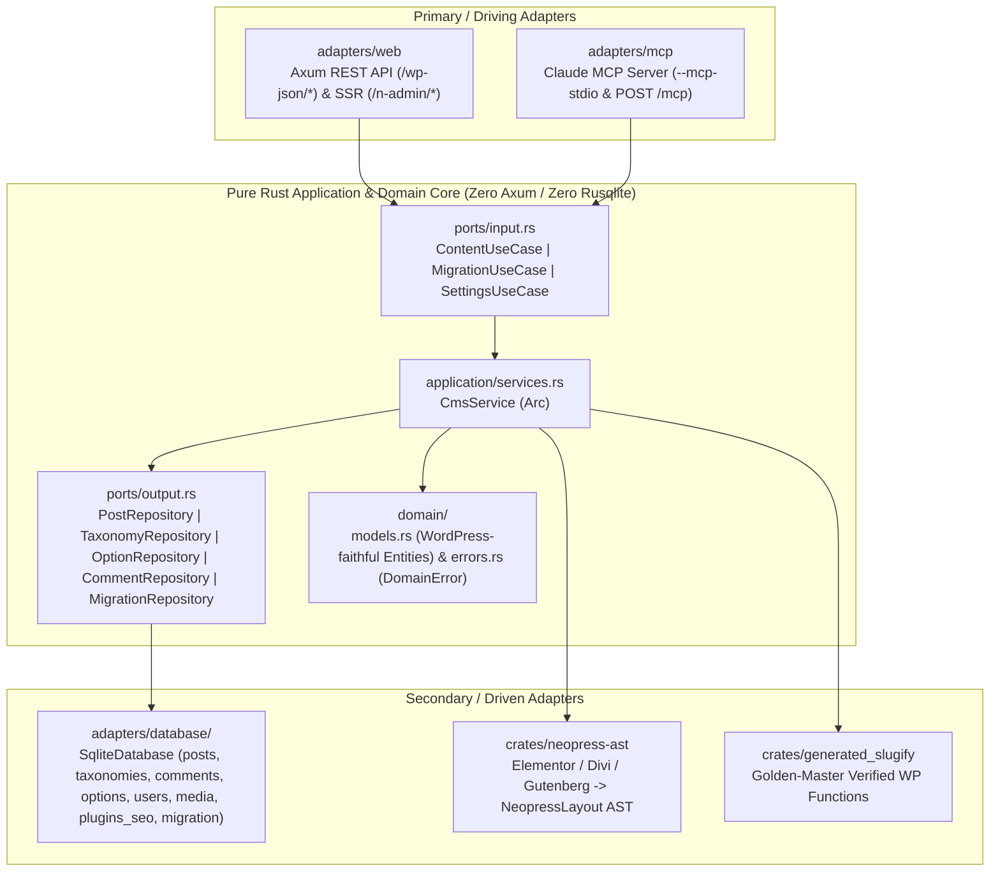

# Neopress ⚡

[](https://github.com/neopress/neopress/actions/workflows/ci.yml)
[](LICENSE)
[](https://www.rust-lang.org)

**Neopress** is a self-hosted, single-binary Rust CMS designed to migrate **70%+ of active WordPress websites** (Elementor, Divi, Gutenberg, and Classic themes) in **1 click** and render an exact visual and functional copy with sub-millisecond latency.

Built with a strict **Hexagonal Architecture** (`domain / ports / application / adapters`), embedded **Rusqlite (WAL)** storage, drop-in **WordPress REST API v2** compatibility, and a **built-in Model Context Protocol (MCP) server**, Neopress makes it effortless to migrate legacy PHP WordPress sites into a clean Rust codebase that you can maintain and update directly with **Claude** or any AI coding assistant.

---

## 🌟 Star Capabilities

- **🚀 1-Click WordPress Migration & Relational Remapping**:
  - Migrate live WordPress sites via the 1-Click JSON bundle endpoint (`POST /wp-json/neopress/v1/import`) or streaming WXR XML (`POST /wp-json/neopress/v1/import-wxr`).
  - Deterministic `old_post_id -> new_post_id` and `old_term_id -> new_term_id` remapping preserves `post_parent`, `page_on_front`, `page_for_posts`, `_thumbnail_id`, categories, tags, navigation menus, and nested comments without broken links.
- **🎨 Unified Page Builder AST (`neopress-ast`)**:
  - Automatically transpiles Elementor (`_elementor_data` + `ElementorKit` global styles), Divi (`[et_pb_*]` shortcodes), and Gutenberg (`<!-- wp:* -->` blocks) into a unified `NeopressLayout` AST and zero-JS semantic HTML.
- **🔁 Universal Plugin Convergence**:
  - Automatically converges **Yoast SEO** & **RankMath** postmeta, **Contact Form 7** & **WPForms** shortcodes, **Redirection** 301/302 rules, and **Joinchat / Click to Chat** WhatsApp settings into native Rust subsystems during migration.
- **🤖 Built-in Claude / AI MCP Server (`--mcp-stdio` & `/mcp`)**:
  - Connect **Claude Desktop**, **Claude Code**, or **Cursor** directly to your Neopress instance via stdio (`neopress --mcp-stdio`) or HTTP JSON-RPC (`POST /mcp` / `POST /wp-json/neopress/v1/mcp`) to list, draft, edit, and publish posts, inspect/update Visual Builder AST layouts, manage settings, or trigger WordPress migrations.
- **🧱 Clean Hexagonal Architecture for AI & Contributor Ergonomics**:
  - Pure domain models (`domain/`), trait-based input/output ports (`ports/`), dependency-injected use-case orchestration (`application/`), and small, focused repository adapters (`adapters/database/`) keep files concise and self-contained for AI context windows.

---

## 🏛️ Hexagonal Architecture Overview



### Directory Structure (`crates/neopress-server/src/`)

```text
src/
├── domain/                  # Pure Rust. Zero web framework (Axum) or DB (Rusqlite) dependencies.
│   ├── models.rs            # Canonical WordPress-faithful domain models (WpPostResponse, etc.)
│   └── errors.rs            # Pure business error enum (DomainError & DomainResult<T>)
├── ports/                   # The "Interfaces" (Rust Traits)
│   ├── input.rs             # Driving use cases: ContentUseCase, MigrationUseCase, SettingsUseCase
│   └── output.rs            # Driven repositories: PostRepository, TaxonomyRepository, OptionRepository, CommentRepository, MigrationRepository
├── application/             # Pure business logic orchestrator
│   └── services.rs          # CmsService holding Arc<dyn ...Repository>, implementing input ports
├── adapters/                # Infrastructure & dirty edge (Axum, Rusqlite, QuickXML, MCP JSON-RPC)
│   ├── database/            # Focused, AI-friendly SQLite repository modules:
│   │   ├── mod.rs           # SqliteDatabase / Database struct definition
│   │   ├── schema.rs        # WAL schema initialization & seeding
│   │   ├── posts.rs         # Posts, pages, revisions, layouts + impl PostRepository
│   │   ├── taxonomies.rs    # Categories, tags, menus + impl TaxonomyRepository
│   │   ├── comments.rs      # Comments CRUD & moderation + impl CommentRepository
│   │   ├── options.rs       # wp_options & settings sections + impl OptionRepository
│   │   ├── users.rs         # Users, auth credentials, application passwords, GDPR tools
│   │   ├── media.rs         # Media attachments CRUD
│   │   ├── plugins_seo.rs   # Plugins, SEO, redirects, 404 logs, forms, backups, analytics
│   │   └── migration.rs     # 1-Click WP bundle & WXR migration + impl MigrationRepository
│   ├── web/                 # Axum HTTP IntoResponse mappings & REST/SSR route handlers
│   └── mcp/                 # Built-in Model Context Protocol (MCP) JSON-RPC 2.0 Server
└── main.rs                  # The "Composition Root" (Wires SqliteDatabase -> CmsService -> Axum / MCP)
```

---

## 🏁 Self-Hosted Quickstart

### 1. Clone & Build

```bash
git clone https://github.com/neopress/neopress.git
cd Neopress

# Build and run the server (defaults to port 8090 and data/neopress.sqlite)
cargo run -p neopress-server --bin neopress
```

### 2. Access Your Instance

- **🌐 Public Website**: [http://localhost:8090/](http://localhost:8090/)
- **⚙️ Admin Dashboard**: [http://localhost:8090/n-admin/](http://localhost:8090/n-admin/) (or `/wp-admin/`)
- **🎨 Visual Studio Builder**: [http://localhost:8090/n-admin/builder.php](http://localhost:8090/n-admin/builder.php)
- **📡 WordPress REST API v2**: [http://localhost:8090/wp-json/](http://localhost:8090/wp-json/)
- **🤖 Claude MCP HTTP Endpoint**: `POST http://localhost:8090/mcp` (or `POST http://localhost:8090/wp-json/neopress/v1/mcp`)

---

## 🤖 Connecting Claude Desktop / Claude Code via MCP

Neopress ships with a native **Model Context Protocol (MCP)** server out of the box—no Node.js wrapper or external plugin required.

### Option A: Stdio Transport (`claude_desktop_config.json`)

Add the following to your Claude Desktop or Claude Code MCP configuration:

```json
{
  "mcpServers": {
    "neopress": {
      "command": "/absolute/path/to/Neopress/target/release/neopress",
      "args": ["--mcp-stdio", "--db", "/absolute/path/to/Neopress/data/neopress.sqlite"]
    }
  }
}
```

### Option B: HTTP JSON-RPC Transport

Send standard MCP JSON-RPC 2.0 requests to `POST http://localhost:8090/mcp`:

```bash
curl -X POST http://localhost:8090/mcp \
  -H "Content-Type: application/json" \
  -d '{"jsonrpc":"2.0","id":1,"method":"tools/list","params":{}}'
```

### Built-In MCP Tools Available to Claude

| Tool Name | Description |
| :--- | :--- |
| `neopress_list_posts` | List WordPress posts or pages with status and keyword search filters. |
| `neopress_get_post` | Fetch a single post or page by numeric `id` or URL `slug`. |
| `neopress_create_post` | Create and publish/draft a new WordPress post or page. |
| `neopress_update_post` | Update title, HTML content, excerpt, status, or SEO metadata of a post/page. |
| `neopress_get_post_layout` | Inspect the `NeopressLayout` Visual Builder AST JSON for a post/page. |
| `neopress_update_post_layout` | Validate and save a `NeopressLayout` AST JSON and automatically compile SSR HTML. |
| `neopress_list_terms` | List categories (`category`) or tags (`post_tag`). |
| `neopress_get_settings` | Read site settings (`blogname`, `siteurl`, front-page IDs, active theme, menus). |
| `neopress_update_option` | Persist any `wp_options` setting (`blogname`, `blogdescription`, etc.). |
| `neopress_import_wp_bundle` | Execute a 1-Click WordPress JSON bundle migration with relational remapping & AST transpilation. |

---

## 🧪 Testing & Verification

Run the full 67-test workspace verification suite:

```bash
cargo test --workspace
```

- **`generated_slugify` (5 tests)**: Golden-Master differential verification of WordPress core string/slug/autop/shortcode functions.
- **`neopress-ast` (9 tests)**: Elementor (`_elementor_data` + `ElementorKit`), Divi (`[et_pb_*]`), Gutenberg (`<!-- wp:* -->`), and Visual Builder AST round-trip & SSR tests.
- **`neopress-server` Unit Tests (18 tests)**: Hexagonal `CmsService` pure mock repository tests, MCP JSON-RPC 2.0 tool execution tests, Universal Plugin Convergence tests, relational 1-Click bundle remapping tests, JWT/Application Password/Nonce crypto tests, and WXR streaming parser tests.
- **`api_tests` (18 tests)**: End-to-end HTTP integration tests across `/wp-json/wp/v2/*`, `/wp-json/neopress/v1/*`, `/n-admin/*`, and public SSR routes.
- **`db_tests` (17 tests)**: Transactional SQLite WAL persistence tests across all repositories.

---

## 📄 License (AGPLv3 + Commercial Dual-License)

Neopress is distributed under a **Dual-License** model:

1. **Open-Source Self-Hosted License ([GNU Affero General Public License v3.0 — AGPL-3.0-or-later](LICENSE))**:
   - Free to install, self-host, modify, and redistribute under the terms of the AGPLv3.
2. **Commercial License ([LICENSE-COMMERCIAL.md](LICENSE-COMMERCIAL.md))**:
   - Available for organizations embedding Neopress into proprietary software or operating closed-source managed SaaS offerings without AGPLv3 network disclosure obligations.
