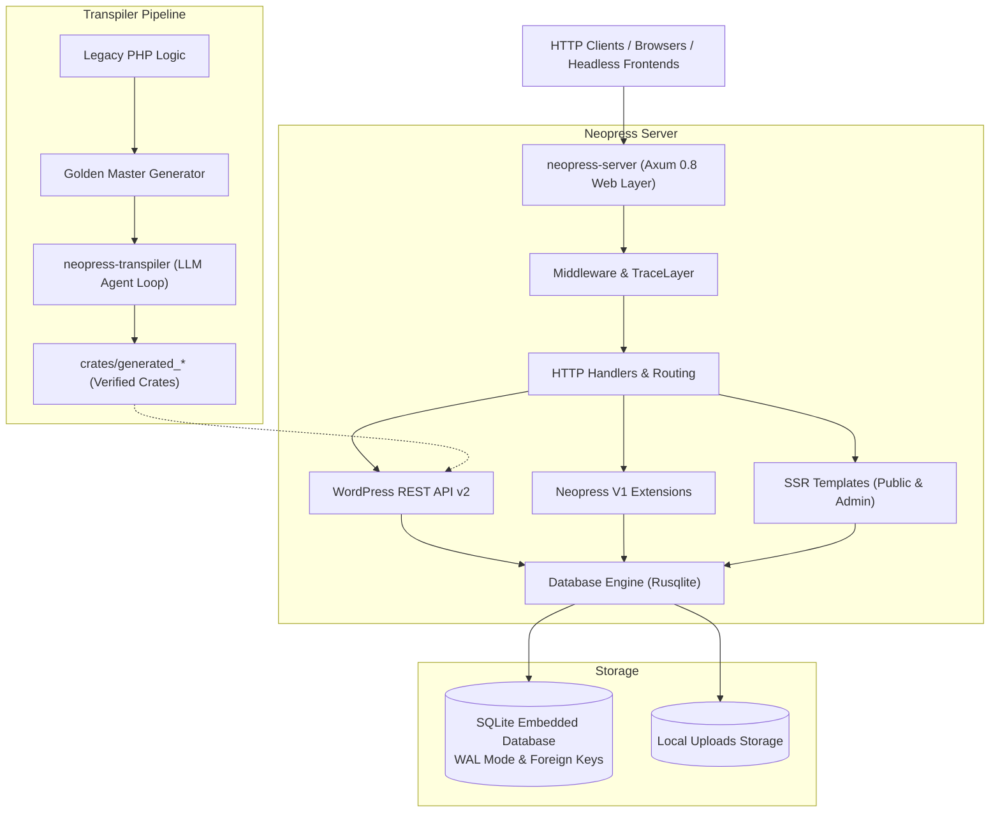

# Neopress ⚡

[](https://github.com/neopress/neopress/actions/workflows/ci.yml)
[](Cargo.toml)
[](https://www.rust-lang.org)

**Neopress** is an industry-grade, ultra-high-performance Content Management System (CMS) written in native Rust. Designed as a memory-safe, lightweight, and modern alternative to legacy PHP WordPress installations, Neopress delivers drop-in **WordPress REST API v2** compatibility, embedded transactional storage with **Rusqlite**, sub-millisecond query latencies, Server-Side Rendering (SSR) for editorial publishing, an authentic administration portal, and an automated AI-assisted PHP-to-Rust transpilation pipeline.

---

## 🚀 Key Features

- **⚡ Sub-Millisecond Latency**: 0 network socket overhead for database transactions. Embedded SQLite with write-ahead logging (WAL) executes post retrievals in under 0.15ms.
- **🔌 Drop-In WordPress REST API v2**: Implements standard endpoints (`/wp-json/wp/v2/posts`, `pages`, `media`, `categories`, `tags`, `users`, `settings`) matching WordPress schema and status codes.
- **🎨 Visual Builder (Leptos Wasm)**: Client-side drag-and-drop page builder compiled to WebAssembly running at native 60fps, saving to a typed JSON layout schema with zero runtime JavaScript on public SSR pages.
- **🔄 Page Builder AST Transpiler**: Native parser converting Elementor `_elementor_data` JSON and Divi shortcode trees into clean Neopress JSON schemas during WXR import (capturing 70% WP builder market share).
- **🛑 Zero "Plugin Tax" Core Convergence**: Native Rust subsystems for transactional email (`lettre`), dynamic SEO/sitemaps (schema.org JSON-LD), and declarative forms/webhooks built directly into the binary.
- **☁️ Edge SaaS Multi-Tenancy & Litestream**: Continuous, zero-data-loss SQLite WAL streaming to S3/Cloudflare R2, paired with automated custom domain/TLS provisioning for agency SaaS scale ($199/mo tier).
- **📊 Cookieless Privacy Analytics & GTM Bridge**: Native, cookie-free analytics with 24-hour rotating salted hashes (no consent banner needed) and a typed Leptos-to-JavaScript bridge for Google Tag Manager Consent Mode v2.
- **🔐 Native Authentication & Nonces**: Full support for standard WordPress Application Passwords, Bearer JWT tokens (`jwt-auth/v1`), and `X-WP-Nonce` validation for seamless headless frontend and mobile integration.
- **🖼️ On-The-Fly Media & WebP Engine**: Automatically computes image dimensions, generates standard thumbnail crops (`thumbnail`, `medium`, `large`), and produces modern WebP variants on-the-fly with immutable caching headers.
- **📥 Streaming WXR Importer**: Drag-and-drop standard WordPress `.xml` dumps directly in the admin portal (`/n-admin/tools.php`) or via streaming API (`/wp-json/neopress/v1/import-wxr`) powered by `quick-xml`.
- **🛡️ Industrial Memory Safety**: 100% Rust memory safety, zero-panic architecture with custom `AppError` types conforming to WordPress REST error specifications.
- **🤖 Mathematical Transpiler Pipeline**: Verify PHP-to-Rust transpilation using automated Golden Master differential testing loops (`neopress-transpiler`).

---

## 🏛️ Architecture Overview

Neopress is organized as a clean **Virtual Cargo Workspace**:



### Workspace Crates

| Crate | Path | Responsibility |
|---|---|---|
| **`neopress-server`** | `crates/neopress-server` | Primary web server, REST API, admin shell, database persistence, native subsystems, and SSR engine. |
| **`neopress-ast`** | `crates/neopress-ast` | Page builder AST transpiler (Elementor `_elementor_data` JSON & Divi shortcode grammar -> Neopress JSON & semantic HTML). |
| **`neopress-transpiler`** | `crates/neopress-transpiler` | CLI verification loop that transpiles legacy PHP functions into Rust and tests them against Golden Master test baselines. |
| **`generated_slugify`** | `crates/generated_slugify` | Golden Master verified implementation of WordPress `sanitize_title_with_dashes`. |

---

## 🏁 Quickstart

### Prerequisites

- **Rust 1.80+** (with `cargo`)
- *(Optional)* Node.js or PHP 8+ if generating new Golden Master test records.

### 1. Clone & Build

```bash
git clone https://github.com/neopress/neopress.git
cd Neopress

# Build the entire workspace in release mode
cargo build --release
```

### 2. Configure Environment

Copy the example configuration:

```bash
cp .env.example .env
```

Available variables:
- `PORT`: HTTP server listening port (default: `8080`)
- `DATABASE_PATH`: SQLite database file path (default: `data/neopress.sqlite`)
- `RUST_LOG`: Logging verbosity filter (default: `info,neopress_server=debug,tower_http=info`)

### 3. Run Neopress Server

```bash
cargo run -p neopress-server
```

Once running, navigate to:
- **Public Site**: [http://localhost:8080/](http://localhost:8080/)
- **Administration Portal**: [http://localhost:8080/n-admin/](http://localhost:8080/n-admin/) (or [http://localhost:8080/wp-admin/](http://localhost:8080/wp-admin/))
- **REST API Discovery**: [http://localhost:8080/wp-json/](http://localhost:8080/wp-json/)

---

## 🛠️ CLI Runner Scripts

Neopress includes convenient execution scripts in `bin/`:

- **Transpiler Verification Loop**:
  ```bash
  # Linux / macOS
  ./bin/neopress-transpiler --target path/to/func.php --golden-master tests/func.json --output crates/generated_func/src/lib.rs

  # Windows PowerShell / CMD
  .\bin\neopress-transpiler.bat --target path\to\func.php --golden-master tests\func.json --output crates\generated_func\src\lib.rs
  ```

---

## 🧪 Testing & Code Quality

Neopress maintains an automated test suite across unit, database, and HTTP integration layers:

```bash
# Run all workspace unit and integration tests
cargo test --workspace

# Run Clippy linter with strict warning enforcement
cargo clippy --workspace --all-targets -- -D warnings

# Check code formatting
cargo fmt --check
```

### Test Breakdown (48 Tests Passing Across Workspace)

- **`db_tests`**: 17 integration tests covering database initialization, transactional CRUD, search queries, media attachments, taxonomy associations, vacuum, atomic bundle imports, comment moderation, writing/reading/discussion/media/permalink/privacy settings persistence, WXR XML export with GDPR data erasure, hybrid JSON layout persistence with dual-write, native declarative forms/entries, cookieless daily-salted analytics aggregation, and native transactional email audit logs.
- **`api_tests`**: 17 integration tests covering root REST discovery, CRUD posts, error responses, SSR layouts, admin dashboard, Application Passwords, Bearer JWT, Nonce validation, media uploads with thumbnail metadata, WXR stream ingestion, all 32 admin menu routes rendering, interactive action APIs, backward-compatible `/wp-admin/` redirects, visual builder layout endpoints with public SSR synchronization, native forms submission with honeypot anti-spam defense, cookieless analytics event ingestion and reporting, automated WXR page builder AST transpilation for Elementor and Divi, and native dynamic SEO XML sitemaps, robots.txt, and transactional email API dispatch.
- **`neopress-ast`**: 2 unit tests validating AST translation and semantic HTML pre-rendering for Elementor `_elementor_data` JSON and Divi `[et_pb_*]` shortcode trees.
- **`neopress-server` Unit Tests**: 8 unit tests validating HMAC nonces, application password generation, JWT encoding/decoding, image dimension scaling, URL crop pattern parsing, WXR event-driven ingestion, and HTML sanitization.
- **`neopress-transpiler`**: 3 unit tests verifying code fence extraction, generic fence parsing, and LLM response sanitization.
- **`generated_slugify`**: Mathematical regression tests verifying slug generation against real WordPress outputs.

---

## 📖 Further Documentation

- **[Architecture Deep-Dive](ARCHITECTURE.md)**: Workspace layout, database concurrency, error taxonomy, and security model.
- **[REST API Reference](API.md)**: Complete endpoint documentation for WordPress REST API v2 and Neopress v1 system extensions.
- **[Contributing Guidelines](CONTRIBUTING.md)**: Developer setup, coding conventions, and pull request checklist.

---

## 📄 License

Licensed under either of:
- Apache License, Version 2.0 ([LICENSE-APACHE](http://www.apache.org/licenses/LICENSE-2.0))
- MIT license ([LICENSE-MIT](http://opensource.org/licenses/MIT))

at your option.
