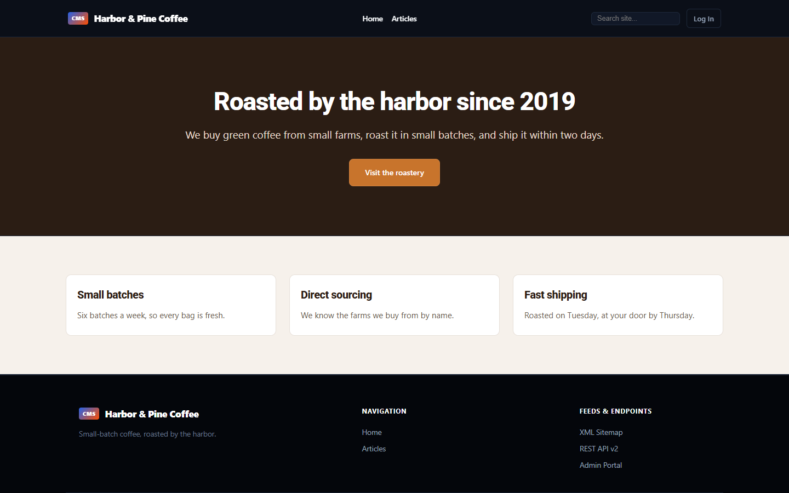
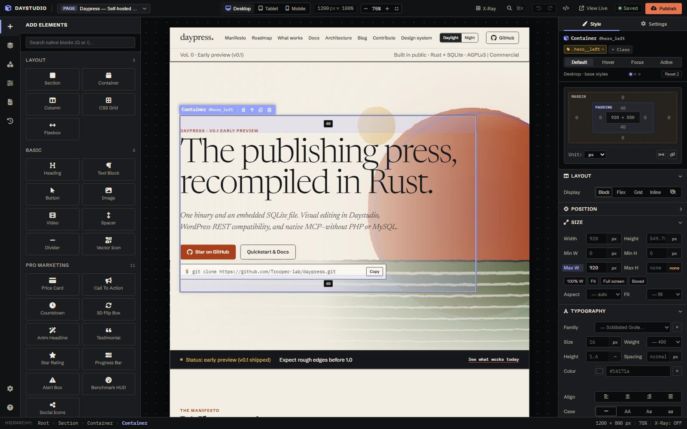
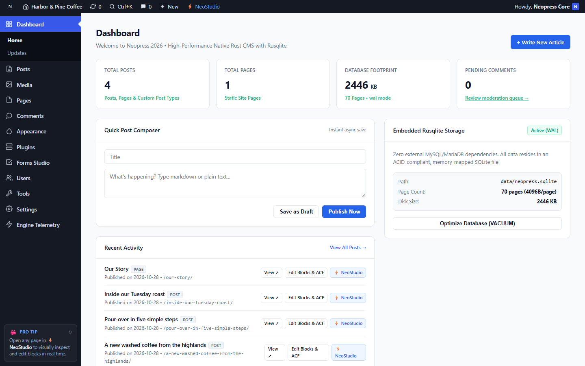
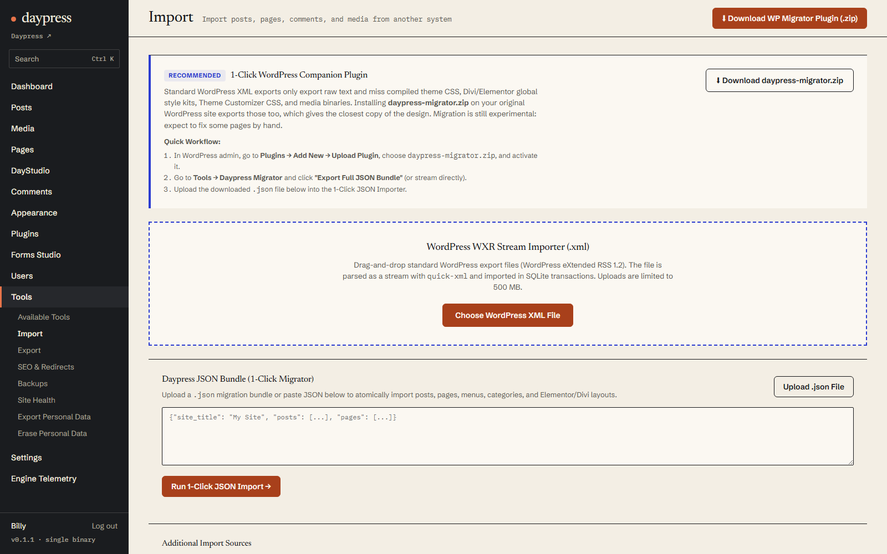
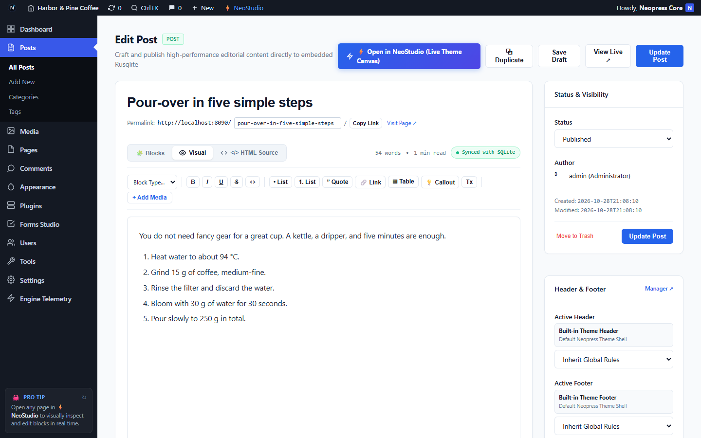
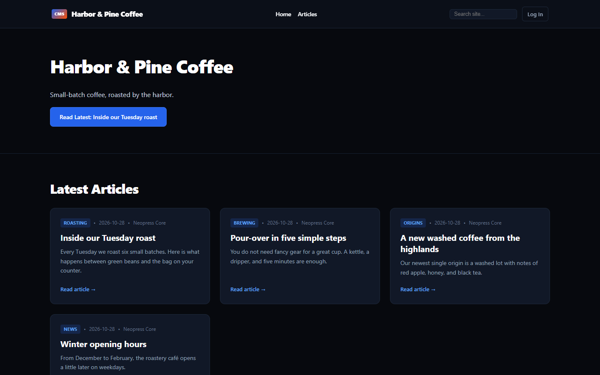

# Daypress

[](https://github.com/Trooper-lab/daypress/actions/workflows/ci.yml)
[](LICENSE)

**Daypress is a self-hosted CMS written in Rust.** It gives you a WordPress-style admin, a visual page builder, and a WordPress-compatible REST API in a single binary with an embedded SQLite database: no PHP, no MySQL.

The long-term goal is a CMS that most WordPress sites can move to with their content and design intact. **We are not there yet.** Today Daypress is good for building new sites, and it has an experimental WordPress importer that we want to improve together with the community.

> **Status: early preview (v0.2.1).** Expect rough edges, missing features, and breaking changes before 1.0. Don't use it yet for sites where downtime or data loss would hurt, and keep backups. The sections below list what works and, just as important, what doesn't.

| Public site | DayStudio visual builder |
| :---: | :---: |
|  |  |

<sub>The screenshots use made-up demo content.</sub>

---

## What works today

**Running it**
- One binary built with Axum and Tokio, with an embedded SQLite database (WAL mode). Static assets are compiled into the binary.
- First-time browser onboarding wizard (/setup, /d-admin/install, /d-admin/setup): configure your site title, tagline, administrator account, starter theme (Daypress Daylight, Daypress Night, or Daypress Modern), accent color, typography scale, and starter mode (sample content, blank site, or 1-click WordPress import) in one screen.
- Built-in self-updater (`/d-admin/updates` and `/d-admin/system?tab=updates`): 24-hour background GitHub release check, SHA-256 checksum verification, automatic pre-update SQLite snapshot, atomic executable hot-swap, manual `.tar.gz` / `.zip` archive upload, and 1-click rollback.
- A release workflow builds binaries for Linux (x86_64), Windows (x86_64), and macOS (Apple Silicon and Intel) for each version tag and attaches them, with SHA-256 checksums, to the GitHub release.
- A `Dockerfile` and `docker-compose.yml` that keep the database, uploads, and backups in one volume.
- CI builds and tests every change on Linux, Windows, and macOS.

**Writing and managing content**
- Posts, pages, categories, tags, and navigation menus.
- A post editor with visual, block, and HTML source modes, plus automatic revision snapshots on edit with restore/delete controls and a bulk revision cleanup tool in `/d-admin/tools`.
- Media uploads, with thumbnail, medium, and WebP versions generated automatically.
- Comments with moderation and discussion settings (who can comment, manual approval).
- Users with application passwords, per-user session sign-out ("Log Out Everywhere Else" on `/d-admin/profile`), plus personal data export and erase tools.
- Blog index, category, tag, and author archives with pagination, plus site search.
- Scheduled posts and a configurable site time zone (`timezone_string` / `gmt_offset` under **Settings → General**, also applied to naive timestamps during WXR and JSON bundle imports): publish with a future date, and the post stays off the site, the feeds, `sitemap.xml`, and the public REST API until that time.
- RSS 2.0 and Atom 1.0 feeds for the blog (`/feed/`, `/feed/atom/`), categories and tags (`/category/<slug>/feed/`, `/tag/<slug>/feed/`), site-wide comments (`/comments/feed/`, `/comments/feed/atom/`), and per-post comment feeds (`/<slug>/feed/`), with `<link rel="alternate">` discovery tags.
- A new install starts with sample content you can edit or delete: a "Hello world!" post, a sample page, and a page built with DayStudio.

**Designing the site**
- **DayStudio**, a drag-and-drop page builder: sections, containers, grids, headings, text, buttons, images, video, and more. Layouts are stored as JSON and rendered on the server.
- The DayStudio canvas loads the site's header, footer, and theme CSS, and matches the published page across desktop (`1200px`), tablet (`768px`), and mobile (`375px`) breakpoints, including root-level (`body`, `:root`, `html`) container queries and font-stack parity.
- A header and footer manager with starter templates and per-page rules.
- A customizer for colors, fonts, and custom CSS.

**Built-in site features**
- SEO fields per post, `sitemap.xml`, `robots.txt` (including "discourage search engines"), redirects, and a 404 log.
- Forms Studio, with email notifications over SMTP.
- SQLite backup snapshots you can create, download, and restore.
- Simple built-in visitor analytics.

**Security basics**
- No default password: the first start generates one (or uses `DAYPRESS_ADMIN_PASSWORD`).
- Passwords are hashed with argon2id, and failed logins are rate-limited.
- A "Lost your password?" email flow with single-use reset links that expire after an hour, plus a `daypress reset-password` command for when email isn't set up.
- The admin area and the write APIs require authentication: a session cookie, an application password (Basic auth), or a JWT.

**APIs**
- A subset of the WordPress REST API (`/wp-json/wp/v2/`): posts, pages, media, categories, tags, comments, users, settings, menus, search, and more.
- Daypress-specific endpoints under `/wp-json/daypress/v1/` for imports, builder layouts, forms, and analytics.
- A built-in [MCP](https://modelcontextprotocol.io) server, so AI assistants such as Claude can read and edit content ([details below](#connecting-an-ai-assistant-mcp)).

**Migration from WordPress (experimental)**
- A WordPress plugin (`daypress-migrator.zip`, downloadable from **Tools → Import**) that exports content, menus, media, theme CSS, and Elementor or Divi global styles as one JSON bundle.
- An importer for standard WordPress export files (WXR), up to 500 MB.
- Elementor, Divi, and Gutenberg layouts are converted into DayStudio layouts, and old post and term IDs are remapped, so parents, menus, featured images, and comments stay linked.
- Data from Yoast SEO, Rank Math, Contact Form 7, WPForms, Redirection, and Joinchat is converted into the matching built-in features.



---

## What doesn't work yet

This list is long on purpose. If something here matters to you, an issue or pull request is very welcome.

**Installing and updating**
- There is no installer, no distribution package, and no published Docker image (you build the image yourself with `docker compose`).
- The binaries are not code-signed, so macOS Gatekeeper and Windows SmartScreen warn before running them.
- Built-in self-updater in `/d-admin/updates` (or manual `.tar.gz` / `.zip` archive upload) with automatic pre-update SQLite snapshot and 1-click rollback.
- The database schema may still change before 1.0, so back up before upgrading.

**WordPress compatibility**
- **WordPress plugins and themes do not run.** Daypress does not execute PHP. Only the plugins listed above have their data converted; everything else is lost or needs rebuilding.
- The REST API covers the common endpoints, not all of WordPress's. Tools that rely on less common endpoints may not work.
- No WooCommerce or other e-commerce.
- No multisite and no multilingual support (WPML, Polylang).

**Migration quality**
- "Most WordPress sites in one click" is the goal, not something we have measured. So far the importer is tested against four fixture sites: WordPress theme unit test data, a Gutenberg site, an Elementor starter site, and a custom theme with ACF fields. There are also unit tests for Divi layouts.
- Expect pages that look different from the original, especially with Elementor Pro widgets, Divi modules, and custom theme code. You will usually need to fix some pages by hand.
- Your [migration reports](https://github.com/Trooper-lab/daypress/issues/new/choose) are the fastest way to improve this.

**Content and publishing**
- Atom 1.0 feeds (`/feed/atom/`), RSS 2.0 & Atom comments feeds (`/comments/feed/`, `/comments/feed/atom/`), per-post comment feeds (`/{slug}/feed/`), and `<link rel="alternate">` discovery tags are built in.
- Post and page revision snapshots are saved automatically on edit, with restore/delete controls in the Post Editor and a bulk revision cleanup tool in `/d-admin/tools` (`/wp-json/daypress/v1/revisions/clean`).
- Site time zone (`timezone_string` / `gmt_offset`) is configurable in **Settings &rarr; General** and applied to scheduled `future` posts as well as naive timestamps during WXR and JSON bundle imports.
- No two-factor authentication.
- Per-user session sign-out ("Log Out Everywhere Else") is available on `/d-admin/profile` (`/wp-json/daypress/v1/users/{id}/sessions/destroy-others`), alongside `daypress reset-password --sign-out-everyone`.
- Roles are coarse: administrators manage everything, while editors, authors, and contributors can all edit and publish all content.
- The admin is English-only, with no translation system yet.

**Builder and design**
- The DayStudio canvas matches the published page across desktop (`1200px`), tablet (`768px`), and mobile (`375px`) breakpoints, including root-level (`body`, `:root`, `html`) container queries and font-stack parity.

**Performance and security**
- There are no published benchmarks yet, and no caching layer or CDN integration.
- The code has not had an external security audit. Please report problems privately; see [SECURITY.md](SECURITY.md).

**Code**
- The `domain / ports / application` layering is only partly applied. Many request handlers still talk to the database adapter directly.

---

## Where help is wanted

- Code-signed binaries, distribution packages, and a published Docker image
- Automated benchmarks, caching layer, and CDN integration
- Two-factor login
- Real per-role permissions
- Migration reports and fixes for real-world Elementor, Divi, and Gutenberg sites
- Translations for the admin

See [CONTRIBUTING.md](CONTRIBUTING.md) to get started.

---

## Quickstart

### 1. Install and run

Daypress keeps its state in the directory it runs from: the database (`data/daypress.sqlite` by default), media in `uploads/`, backup snapshots in `backups/`, and imported theme files in `static/themes/`. Give it a directory of its own.

**Prebuilt binary.** Download the archive for your platform and `SHA256SUMS` from the [Releases page](https://github.com/Trooper-lab/daypress/releases). Releases tagged before the release workflow was added have no binaries. Check the download and start the server:

```bash
sha256sum --check --ignore-missing SHA256SUMS
tar -xzf daypress-<version>-x86_64-unknown-linux-gnu.tar.gz
./daypress-<version>-x86_64-unknown-linux-gnu/daypress
```

On Windows, unzip the `.zip` file and run `daypress.exe`. The binaries are not code-signed: on macOS, clear the download quarantine with `xattr -d com.apple.quarantine daypress` before the first start.

**Docker.** There is no published image yet, so Compose builds it from the source (this takes a few minutes the first time):

```bash
git clone https://github.com/Trooper-lab/daypress.git
cd daypress
docker compose up -d --build
docker compose logs daypress
```

The database, uploads, and backups live in the `daypress_daypress-data` volume. Set `DAYPRESS_ADMIN_PASSWORD` and the `DAYPRESS_SMTP_*` variables (see below) in your shell or in a `.env` file next to `docker-compose.yml`. To use another port on the host, change `ports:` in the compose file.

**From source.** You need a recent stable [Rust toolchain](https://rustup.rs).

```bash
git clone https://github.com/Trooper-lab/daypress.git
cd daypress
cargo run --release -p daypress-server --bin daypress
```

By default the server listens on port 8090 and stores its database in `data/daypress.sqlite`. Change them with `--port` / `PORT` and `--db` / `DATABASE_PATH`.

- Public site: <http://localhost:8090/>
- Admin: <http://localhost:8090/d-admin/>
- DayStudio builder: <http://localhost:8090/d-admin/builder>
- REST API: <http://localhost:8090/wp-json/>

### 2. First login

There is no default password. On first start Daypress creates an `admin` account and prints a generated password **once** to the console (stderr):

```text
🔐 Generated a password for 'admin' (shown only once):
   <generated-password>
```

Log in at <http://localhost:8090/login> and change it under **Users → Profile**. To choose the initial password yourself (for example in CI), set `DAYPRESS_ADMIN_PASSWORD` before the first start.

Repeated failed logins from the same address are throttled (5 attempts per 15 minutes per account).

**Lost the password?** Use **Lost your password?** on the login page. It emails a reset link that works once and expires after an hour. This needs SMTP (see below) and the right **Site Address (URL)** under **Settings → General**, because the link is built from it. Without email, reset the password on the server:

```bash
daypress reset-password admin --db data/daypress.sqlite
```

This prints a new generated password once. To choose it yourself, set `DAYPRESS_NEW_PASSWORD` first. Existing logins stay valid until they expire; add `--sign-out-everyone` to end every session (application passwords keep working). With Docker, run `docker compose exec daypress daypress reset-password admin`.

### 3. Email (SMTP)

Form notifications are sent over SMTP. Configure it with environment variables and restart. Then use **Settings → General → Send test email** to check the setup. Without `DAYPRESS_SMTP_HOST` nothing is sent, and the email log records `not_sent`.

| Variable | Meaning |
| :--- | :--- |
| `DAYPRESS_SMTP_HOST` | SMTP server (required to send) |
| `DAYPRESS_SMTP_PORT` | Port (default 587; 465 for `tls`, 25 for `none`) |
| `DAYPRESS_SMTP_SECURITY` | `starttls` (default), `tls`, or `none` |
| `DAYPRESS_SMTP_USER` / `DAYPRESS_SMTP_PASSWORD` | Credentials, if your server needs them |
| `DAYPRESS_SMTP_FROM` / `DAYPRESS_SMTP_FROM_NAME` | Sender (defaults: admin email and site title) |

Set the site's admin email under **Settings → General**. A new install uses `admin@example.com` until you change it.

### Upgrading from Neopress v0.1

Daypress was called Neopress up to v0.1.1. The first start of Daypress upgrades a Neopress install in place:

- A `neopress.sqlite` next to the configured database path is moved to `daypress.sqlite`. Its tables lose WordPress's `wp_` prefix (`wp_posts` becomes `posts`), and its options and meta keys are renamed. Backups made with Neopress can still be restored. Class names, CSS tokens and form shortcodes that Neopress stored in pages and templates are renamed too; page text is left as it is.
- `NEOPRESS_*` environment variables keep working. Rename them to `DAYPRESS_*` when convenient.
- `/n-admin/...` links redirect to `/d-admin/...`, and `/wp-json/neopress/v1/...` keeps working for migrator plugins already installed on WordPress sites.
- Everyone logs in once more, because the session cookie has a new name.
- Docker Compose now names the project and volume `daypress`. To keep your data, point the new volume at the old one before you run `docker compose up`:

  ```yaml
  volumes:
    daypress-data:
      name: neopress_neopress-data
  ```

---

## Migrating a WordPress site (experimental)

1. In Daypress, go to **Tools → Import** and download `daypress-migrator.zip`.
2. In WordPress, go to **Plugins → Add New → Upload Plugin**, upload the zip, and activate it.
3. In WordPress, go to **Tools → Daypress Migrator** and click **Export Full JSON Bundle**.
4. Back in Daypress, upload the `.json` file under **Tools → Import**.

If you can't install plugins, you can import a standard WordPress export file (**Tools → Export → All content** in WordPress) instead. That gives you the content without the theme CSS and builder global styles.



---

## Connecting an AI assistant (MCP)

Daypress includes a [Model Context Protocol](https://modelcontextprotocol.io) server, so assistants such as Claude Desktop, Claude Code, or Cursor can list, write, and edit content.

**Stdio** (the assistant starts Daypress itself; build with `cargo build --release` first):

```json
{
  "mcpServers": {
    "daypress": {
      "command": "/absolute/path/to/daypress/target/release/daypress",
      "args": ["--mcp-stdio", "--db", "/absolute/path/to/daypress/data/daypress.sqlite"]
    }
  }
}
```

**HTTP** (against a running server): send JSON-RPC 2.0 requests to `POST /mcp`. This requires an administrator, for example with an application password created under **Users → Profile**:

```bash
curl -X POST http://localhost:8090/mcp \
  -u "admin:<application-password>" \
  -H "Content-Type: application/json" \
  -d '{"jsonrpc":"2.0","id":1,"method":"tools/list","params":{}}'
```

| Tool | What it does |
| :--- | :--- |
| `daypress_list_posts` | List posts or pages, filtered by status or keyword |
| `daypress_get_post` | Get one post or page by `id` or `slug` |
| `daypress_create_post` | Create a post or page, as a draft or published |
| `daypress_update_post` | Update title, content, excerpt, status, or SEO fields |
| `daypress_get_post_layout` | Read a page's DayStudio layout (JSON) |
| `daypress_update_post_layout` | Validate and save a DayStudio layout |
| `daypress_list_terms` | List categories or tags |
| `daypress_get_settings` | Read site settings |
| `daypress_update_option` | Change a site option, such as the title or tagline |
| `daypress_import_wp_bundle` | Import a WordPress JSON bundle |

---

## More screenshots

| Post editor | Blog index |
| :---: | :---: |
|  |  |

---

## Project layout

| Path | What's in it |
| :--- | :--- |
| `crates/daypress-server` | The CMS: HTTP routes, admin and public templates, REST API, importers, MCP server, SQLite storage |
| `crates/daypress-ast` | The layout model and the Elementor, Divi, and Gutenberg converters |
| `crates/generated_slugify` | Rust ports of WordPress core functions, checked against output from the original PHP |
| `crates/daypress-transpiler` | Tooling for those PHP-to-Rust ports and their golden-master tests |
| `daypress-migrator.php` | The WordPress plugin that exports a site for import |
| `fixtures/` | Test fixtures, including the four sample WordPress sites |

More detail is in [ARCHITECTURE.md](ARCHITECTURE.md) and [API.md](API.md).

## Development

```bash
cargo test --workspace                                  # 314 tests
cargo clippy --workspace --all-targets -- -D warnings  # no warnings allowed
cargo fmt --check
```

---

## 📄 License (AGPLv3 + Commercial Dual-License)

Daypress is distributed under a **Dual-License** model:

1. **Open-Source Self-Hosted License ([GNU Affero General Public License v3.0 — AGPL-3.0-or-later](LICENSE))**:
   - Free to install, self-host, modify, and redistribute under the terms of the AGPLv3.
2. **Commercial License ([LICENSE-COMMERCIAL.md](LICENSE-COMMERCIAL.md))**:
   - Available for organizations embedding Daypress into proprietary software or operating closed-source managed SaaS offerings without AGPLv3 network disclosure obligations.

Daypress also includes Rust ports of WordPress core functions, which remain under the GNU GPL, and admin fonts under the SIL Open Font License; see [NOTICE](NOTICE). The WordPress migrator plugin (`daypress-migrator.php`) is licensed under GPL-2.0-or-later.

"WordPress" is a trademark of the WordPress Foundation. Daypress is an independent project and is not affiliated with or endorsed by the WordPress Foundation.

---

## 🤝 Contributing & Community

- Read [CONTRIBUTING.md](CONTRIBUTING.md) for the development setup and pull request process. Contributors sign a one-time [CLA](CLA.md).
- Ask questions in [GitHub Discussions](https://github.com/Trooper-lab/daypress/discussions), and report bugs or migration problems as [issues](https://github.com/Trooper-lab/daypress/issues/new/choose).
- Report security vulnerabilities privately, as described in [SECURITY.md](SECURITY.md).
- Everyone in the project follows our [Code of Conduct](CODE_OF_CONDUCT.md).
